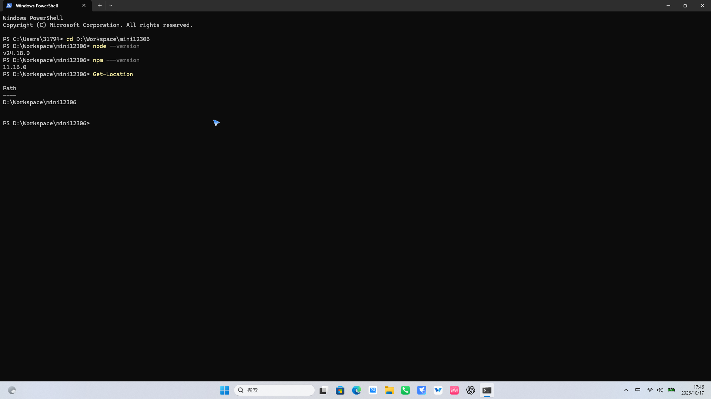
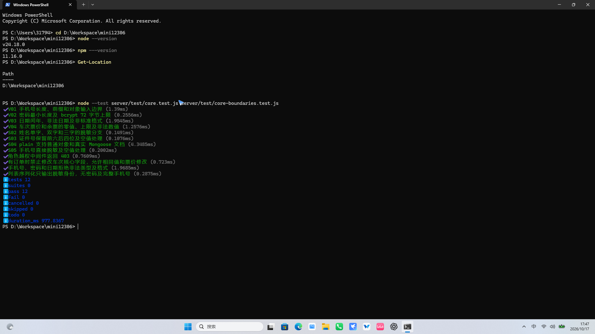
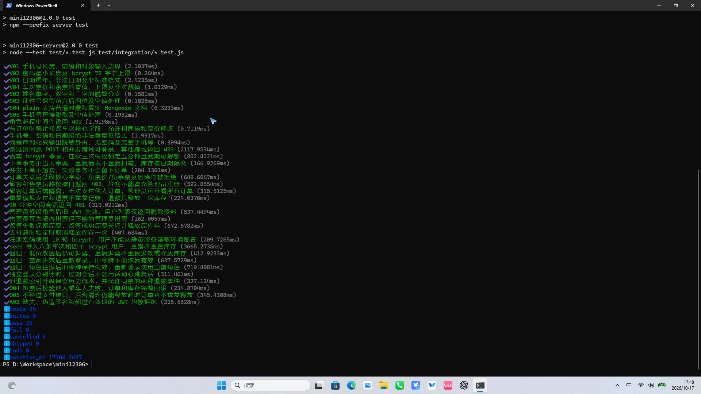

# Mini-12306 全栈项目测试报告

> 状态更新（2026-10-15）：F01、F02、F03 已按用户授权修复，新增回归及兼容性测试后共 24/24 通过。下文第 1～10 节保留修复前的审查证据与结论，修复后结果见第 11 节；F04、F05 及设计风险不在本次修复范围内。

> 补充说明：上述 24/24 是修复时已验证的历史结果。第 12 节另补充核心方法设计和 11 项测试代码，新增用例尚未执行，不能把历史结果当成本次新增代码的运行结果；用户本地结果保留待填写。

- 测试日期：2026-10-15（Asia/Shanghai）。
- 被测项目：`D:\Workspace\mini12306`，当前本地工作区版本。
- 测试类型：需求分析、黑盒/API 测试、代码审查、事务并发验证、浏览器冒烟测试。
- 本次仅新增报告与临时复现脚本，没有修改业务代码，也没有连接或清空 `.data` 中的开发数据库。

## 1. 测试结论与执行范围

**现有 19 项自动化测试全部通过，但新增组合场景复现了 5 项缺陷。建议修复 P1 问题后再验收完整退改签及认证功能。**

通过现有用例并不代表全部业务规则通过；特别是原测试未覆盖低价改签后再退票，以及旧令牌被判失效后再次使用的生命周期。

| 执行项 | 本次结果 | 范围及限制 |
| --- | --- | --- |
| `npm run test` | 19/19 通过，0 失败，约 11.90 秒 | 4 项单元测试＋15 项 API 集成测试；使用真实临时 Mongo 单节点副本集 |
| 新增专项探测 | 13 个场景完成 | 包含失败场景和正向验证，不属于原来的 19 项测试，不计算为原测试覆盖率 |
| 100 路不同请求并发 | 8 次 201、92 次 409 | 2 个日期×2 个席别×每组 2 张票；最终 8 笔订单，各组余票 0；约 6.22 秒 |
| 20 路相同 requestId 并发 | 20 次 201，仅 1 笔订单 | 唯一订单编号 1 个，库存从 2 降到 1；返回多次 201 不等于创建多笔订单 |
| 浏览器冒烟 | 通过 | Edge 无界面模式；旅客查询/下单/支付/退票、角色页面保护、管理员新增车次及核心字段禁改、柜台出票 |
| 响应式检查 | 通过 | 375×812 与 1440×900 冒烟页面无横向溢出，未发现页面脚本异常 |
| Docker / Node.js 20 启动 | 未执行 | 本机未发现 Docker；实际运行环境为 Node.js v24.18.0，不能据此声称 Node 20 容器已验证 |

测试依赖为当前安装版本：Express 4、Mongoose 8；临时 MongoDB 使用 7.0.14、WiredTiger、单节点副本集。测试通过应用真实路由和 Mongoose 模型运行，不使用伪造的数据库事务。

时间类探测通过调整**临时测试数据**的时间戳模拟时间推进，并未实际等待 5、15 或 30 分钟。发车后付款探测也采用修改订单时间的方式准备测试状态。真实时间边界与启动入口定时任务仍需单独补测。

## 2. 测试策略：按模块拆分

| 模块 | 重点测试点 | 应检查的数据不变量 |
| --- | --- | --- |
| 登录认证 | 手机号格式；密码错误 1/2/3 次；5 分钟解锁边界；JWT 缺失、伪造、过期；30 分钟空闲；重新登录；角色往返；退出登录；多设备 | 被撤销/失效的旧会话不能因另一次登录或角色恢复而复活；接口不返回密码哈希 |
| 车次查询 | 城市/车站匹配；日期存在性；空结果；停售；不同日期与席别；余票 0/1/20/21；对象型参数注入；查询后库存变化 | 查询结果属于指定日期；库存与服务端一致，下单时重新核对价格和余票 |
| 下单支付 | 正常下单；余票为零；伪造金额；他人乘车人；重复及冲突幂等键；付款超时；重复支付；付款与取消竞争 | 一笔成功订单只占用一张对应日期/席别库存；异常不留下部分订单或支付记录 |
| 退票改签 | 5% 手续费和分币舍入；重复退款；发车边界；同价/补款/退款改签；跨城市拒绝；改签失败；连续改签后退款 | 订单、支付、退款和库存能对账；改签失败原票有效，成功仅新票有效 |
| 并发防超卖 | 不同用户/不同请求抢最后一张；同请求并发；多日期/多席别；支付/取消/超时/退票竞争；管理员修改并发 | 扣减原子、余票不为负、不能重复释放；无人工调库存时初始库存＝剩余＋有效占用 |
| 角色权限 | 三角色完整接口矩阵；公开注册不能提权；管理员创建职员；旧角色令牌；页面直接访问 | 页面保护与服务端保护同时生效；旅客/售票员不能访问管理员接口 |
| 订单隔离 | A 用户列出/查看/支付/取消/退款/改签 B 用户订单；伪造 userId/passengerId | 服务端以认证用户为准，不能依赖前端隐藏按钮或客户端传入的用户编号 |

执行顺序：先确认基础认证及数据库隔离，再验证单次业务、事务回滚、组合状态转换，最后做小规模并发和浏览器冒烟。每次失败检查 HTTP 状态、订单状态、库存及资金记录，不能只检查页面 Toast。

## 3. 优先黑盒用例（15 条）

共同前提：使用专用测试库；准备未来日期 D、D+1，以及可控制库存的车次 T。旅客 A/B 为两个独立账号，另准备售票员 C、管理员 M。需要查看数据库的断言属于验收核对手段，测试请求仍经 HTTP 发起。不要在真实业务库中直接调整时间或库存。

| 编号/优先级 | 操作步骤 | 预期结果 | 本次执行状态 |
| --- | --- | --- | --- |
| BB01 / P1 登录锁定 | A 连续输错密码 3 次；立刻输入正确密码；模拟/等待锁定 5 分钟后再次登录；检查错误次数清零 | 第 3 次起 423；锁定期间正确密码也不能登录；到期可登录，失败计数归零 | 基础流程通过；精确第 299999/300000 毫秒未测 |
| BB02 / P1 会话空闲及重登 | 保存 A 的令牌 T1；使会话空闲超过 30 分钟；确认 T1 返回 401；重新登录；再次使用 T1 | T1 应持续失效，新会话可以访问 | **失败：重新登录后旧 T1 返回 200** |
| BB03 / P1 角色变更与撤销 | A 保存旅客令牌；M 把 A 改为售票员；用旧令牌访问；M 再把 A 改回旅客；再次使用旧令牌；旅客直接请求管理接口 | 旧令牌在第一次变更后永久失效；普通越权 403，不能因恢复角色而复活 | 普通越权通过；**角色恢复后旧令牌返回 200** |
| BB04 / P2 查询校验 | 查询正确线路 D/D+1；查询不存在的线路；传入空日期、2 月 30 日、相同起终点；传入对象型 from/phone 参数 | 正确查询只显示指定日期；无线路返回空列表；非法参数 400；不能绕过认证或注入查询 | 格式校验/部分注入已测；完整查询边界待补 |
| BB05 / P1 下单边界与回滚 | 设置余票 1；A 正常下单；再次下单；另在有票时传入他人或不存在的 passengerId，使扣票后校验失败 | 首次扣至 0；再次 409；非法乘车人 403 且库存/订单全部回滚；客户端金额不能覆盖服务端票价 | 余票耗尽和扣票后失败回滚通过；金额篡改未独立执行 |
| BB06 / P1 并发抢票 | 2 日期×2 席别，各库存 2；发送 100 个不同 requestId 的并发下单，均匀分配四组 | 只建 8 笔订单，其他请求余票不足；各组剩余 0，无负数或串日/串席 | **通过：8×201、92×409，8 笔订单**；多用户版本待补 |
| BB07 / P1 幂等与冲突 | 同一账号同一请求体和 requestId 发送 20 次；随后复用该 requestId 改为 D+1 | 相同请求只生成 1 笔订单、扣 1 张；不同请求体应拒绝冲突或明确返回原请求结果，不应把旧票当新行程成功 | 相同请求通过；不同日期仍返回 201 和原日期订单，见 R02 |
| BB08 / P1 支付状态竞争 | 建待支付订单；重复支付两次；再建一笔，支付与取消同时发送 | 只记一笔支付；竞争后只能是 paid 或 cancelled 一种合法终态，库存与支付记录一致 | 顺序重复支付通过；竞争样本为 paid、库存 1、支付 1，另一请求 409 |
| BB09 / P1 超时释放 | 创建订单；在 14:59 支付；另建订单，在 15:00 后支付；只等待后台扫描；重复取消/扫描 | 截止前可支付，截止后不能；过期最终 cancelled，库存只释放一次；约定清理允许的延迟 | 超时支付释放和幂等通过；精确边界、真实扫描延迟和重启恢复未测 |
| BB10 / P1 退款金额及重复请求 | 购买并支付 520.50 元车票；退票；重试退票；发车后再尝试；增加小额舍入样本 | 费用 26.03、退款 494.47；只记一笔退款、释放一次库存；发车后拒绝 | 520.50 和顺序重复退票通过；小额/发车边界待补 |
| BB11 / P1 改签差价与失败 | 对已付车票分别选择同价、更贵、更便宜的新票；模拟目标无票/车次无效；选择不同城市线路 | 同价无额外收付；高价只补差、低价只退差；失败原票保持有效、新库存回滚；跨城市不允许 | 同价、低价和无效车次已测；高价/跨城/目标库存耗尽待补 |
| BB12 / P1 低价改签后退票 | 100 元已付票改签到 60 元票，确认退差 40 元；再退新票 | 新票正常退票，按 60 元计算手续费 3 元、退款 57 元；新票库存释放一次 | **失败：退新票 409，新票仍 paid** |
| BB13 / P1 订单隔离与注册提权 | A 创建订单，B 使用其 id 分别读、付、退、取消、改签；B 注册提交 role=admin；旅客调用管理员/售票员接口 | 所有他人订单操作 404/403，不改变记录；注册提权/角色越权 403；仅管理员能列出全部订单 | 列表隔离、他人支付、无归属退款及角色越权通过；整套他人状态转换待补 |
| BB14 / P1 管理员边界 | T 有订单后改车次号/站点/删除；提交负价负票、重复车次、seats:{}；买光后只编辑票价 | 核心字段及删除拒绝；负数/错误类型 400；重复车次 409；单纯改价不应隐式补库存（需确认库存编辑语义） | 核心/负数通过；**seats:{} 返回 500**；改价附带席别使库存回升，见 R01 |
| BB15 / P1 柜台出票 | C 给有效旅客出票；目标改为管理员/锁定账号；复用该旅客待支付订单的 requestId 调柜台出票 | 有效旅客出票 paid，记录 issuedBy 和支付；非法目标拒绝；跨入口幂等冲突应拒绝或受控处理，不能假成功 | 普通出票通过；**碰撞返回 201、订单仍 pending，支付记录 0** |

BB07、BB14 的“不同负载幂等”和“只改价不补库存”是推荐的验收约束，当前需求/实现对这些语义不够明确，报告将其列为设计风险，而不冒充已明确违反既定规则的漏洞。

## 4. 已复现缺陷及代码定位

严重度说明：P1 为阻断核心业务或认证失效语义的问题；P2 为异常处理或特定组合下的功能错误。本次没有证据表明已存在普通旅客直接获得管理员权限的漏洞。

### F01 / P1：低价改签的退款记录阻止新票再次退票

- 位置：[新票差额退款](D:/Workspace/mini12306/server/src/controllers/orders.js:73)、[退票新增退款记录](D:/Workspace/mini12306/server/src/controllers/orders.js:44)、[退款记录 orderId 唯一约束](D:/Workspace/mini12306/server/src/models/index.js:17)。
- 步骤：支付原票 100 元 → 改签到 60 元 → 退新票。
- 实际：改签 200，已产生新订单名下 40 元退差记录；随后退票 409，提示“账号、手机号、车次号或订单编号已存在”，新票仍为 paid。
- 原因：差额退款与最终退票都使用新订单的 orderId 写同一个退款集合，orderId 唯一索引禁止第二笔记录。
- 影响：正常的低价改签用户无法完成后续退票。事务回滚保护了库存，但不能完成业务。
- 建议：将“改签退差”和“退票退款”建模为不同业务事件，使用事件编号或 orderId＋事件类型/操作编号保证幂等，并核对累计金额。不能简单删掉唯一约束后失去重复退款保护。

### F02 / P1：30 分钟空闲失效的旧 JWT 在重新登录后恢复有效

- 位置：[认证仅检查用户级 lastActiveAt](D:/Workspace/mini12306/server/src/middlewares/auth.js:11)、[登录刷新该字段](D:/Workspace/mini12306/server/src/controllers/auth.js:37)、[JWT 只携带角色与用户编号](D:/Workspace/mini12306/server/src/controllers/auth.js:39)。
- 实际：T1 空闲后 `/auth/me` 为 401；重新登录后，同一个旧 T1 再请求返回 200。
- 原因：空闲时间存于 users，而非具体会话；新登录刷新用户时间，使仍在 8 小时签名有效期内的旧令牌重新满足条件。
- 影响：已判定空闲失效的令牌并未被真正撤销；多设备/被复制令牌的生命周期不独立。
- 建议：引入会话 sid/jti、服务端会话状态及会话级活动时间，过期后不可复活；单设备模式也可采用登录版本号，但要明确是否允许多设备。退出登录当前也只清浏览器令牌，缺少服务端撤销入口，见 [api.js](D:/Workspace/mini12306/js/api.js:8)。

### F03 / P1：角色改回原值后旧 JWT 再次有效

- 位置：[只比较 payload.role 与当前 role](D:/Workspace/mini12306/server/src/middlewares/auth.js:11)、[角色修改只更新 role](D:/Workspace/mini12306/server/src/controllers/admin.js:58)。
- 实际：旅客 → 售票员后旧旅客令牌为 401；售票员 → 旅客后同一个旧令牌为 200，无需重新登录。
- 原因：角色相等不能代替“角色变更后撤销已签发令牌”。
- 建议：角色修改同时提升 authVersion 或撤销对应会话；认证时验证版本。管理员降权后再授回权限也应沿用同样的撤销规则。

F02、F03 同属会话撤销模型缺失，可一起设计修复，但触发方式和回归用例应分别保留。可参考 [OWASP JWT 撤销建议](https://cheatsheetseries.owasp.org/cheatsheets/JSON_Web_Token_Cheat_Sheet.html)。这不是对 JWT 签名破解的报告，而是项目服务端会话状态判断的缺陷。

### F04 / P2：柜台出票复用旅客下单幂等键，返回成功但没有出票

- 位置：[幂等查找和直接返回](D:/Workspace/mini12306/server/src/utils/order-service.js:36)、[柜台出票调用](D:/Workspace/mini12306/server/src/controllers/orders.js:15)、[唯一键](D:/Workspace/mini12306/server/src/models/index.js:15)。
- 步骤：旅客 P 用 requestId=same 创建待支付订单；售票员针对同一个 P，使用同 requestId 调柜台出票。
- 实际：HTTP 201，但返回的是原 pending 订单；payment_records 为 0，也没有柜台 issuedBy。
- 原因：幂等作用域只有目标 userId＋requestId，未区分操作入口、操作人或请求内容；命中后跳过柜台支付/出票逻辑。
- 建议：定义业务操作域，记录并比较请求指纹；不同入口冲突返回 409，不能把原来的待支付订单当作已出票成功。前端也应核对返回状态。

### F05 / P2：畸形席别请求返回 500，未走输入校验

- 位置：[先调用 seats.some](D:/Workspace/mini12306/server/src/controllers/admin.js:30)、[后执行 trainInput](D:/Workspace/mini12306/server/src/controllers/admin.js:32)、[席别元素未检查对象类型](D:/Workspace/mini12306/server/src/utils/validation.js:30)。
- 步骤：对有关联订单的车次 PUT `{ "seats": {} }`。
- 实际：500；服务端记录 `TypeError: req.body.seats.some is not a function`。
- 预期：400，说明席别必须为数组；非法值不应成为服务器异常。
- 建议：在业务读取字段前完成请求结构校验，并覆盖 null、数字、对象、数组中的 null、空数组等情况。此次只复现了 seats 对象输入；其他类型为应补测项。

## 5. 已观察到的设计风险（需明确验收规则）

### R01 / P2：保存席别会覆盖所有运营日期的实时库存

位置：[库存覆盖](D:/Workspace/mini12306/server/src/controllers/admin.js:17)、[只要提交 seats 就同步](D:/Workspace/mini12306/server/src/controllers/admin.js:35)、[前端始终提交 seats](D:/Workspace/mini12306/js/management.js:63)。

实测：模板余票 2，旅客买完后某日实际余票 0；管理员读取车次表单，只改价为 101 并保存席别，实际余票变回 2，又可成功创建第 3 笔订单。

**限定说明：README 和表单已声明这是管理员设置绝对余票的功能，并且有确认提示，因此本报告不把它认定为事务扣票超卖漏洞。** 风险在于日常“只调价格/停售”与“主动补库存”耦合，容易误补所有日期库存；数据库也没有物理容量字段可检查总容量上限。建议拆分改价与按日期调库存接口，记录变更原因和调整前后值，增加版本/并发条件及审计。

### R02 / P2：同 requestId 携带不同日期仍返回旧订单成功

位置：[创建订单幂等命中](D:/Workspace/mini12306/server/src/utils/order-service.js:36)。

实测：第一次请求 D，第二次相同键请求 D+1，返回 201、相同订单、日期仍为 D。原始“不能重复建单”规则已满足，但用户改了行程可能收到旧票。建议把“相同键＋不同规范化请求内容”定义为冲突 409，并对车次、日期、席别、乘车人做指纹比较。测试及客户端需区分新业务与网络重试。

### R03 / P2：发车后的待支付订单仍可支付

位置：[支付仅校验状态和 expiresAt](D:/Workspace/mini12306/server/src/controllers/orders.js:23)。

测试数据模拟订单已经发车、但 15 分钟支付窗口仍未结束；支付返回 200、订单为 paid。下单与退改签已校验发车时间，支付没有同类检查。核心需求没有明文规定发车即停止支付，因此此项列为规则缺口。建议明确“支付截止＝下单后 15 分钟与发车时间的较早者”，确认后补相应服务端校验。

## 6. 静态审查风险与并发分析

以下项目没有进行真实攻击压力或生产环境验证，不冒充已复现故障。

1. **同一车次写热点。** [order-service.js:13](D:/Workspace/mini12306/server/src/utils/order-service.js:13) 每次下单都更新车次 revision，所有日期和席别共用同一写入文档。它能与管理员更新形成写冲突保护，但也扩大了争用范围。100 路小规模试验未超卖；不能据此推断高并发容量。应补测不同车次和同车次跨日期的吞吐/尾延迟，记录事务重试与超时。
2. **过期清理放大与全量列表。** [orders.js:7](D:/Workspace/mini12306/server/src/controllers/orders.js:7) 旅客读订单时先清理所有用户的过期订单；[order-service.js:50](D:/Workspace/mini12306/server/src/utils/order-service.js:50) 全量取出后逐条事务处理。模型未建 status＋expiresAt 清理索引，orders.trainId 关联检查也没有索引。列表无分页。小数据演示可用；大积压时可能造成正常查询变慢。建议独立批次清理、索引、分页和耗时监控。
3. **超时释放不是精确到秒的定时器。** [index.js:11](D:/Workspace/mini12306/server/src/index.js:11) 约每 30 秒扫描一次；HTTP 支付路径会即时拒绝超时订单，但无人访问的库存释放存在扫描延迟和执行耗时。应明确允许延迟，并补启动时过期订单清理、真实定时扫描、重启及多个清理者同时处理的测试。
4. **登录/注册缺少请求速率限制。** [公开认证路由](D:/Workspace/mini12306/server/src/routes/index.js:12) 没有限流中间件。三次错误锁账号已实现，但攻击者仍能造成账号锁定或大量触发 bcrypt/注册。尚未进行资源耗尽测试。建议按账号＋来源限速并设置审计；这不等于取消既定三次锁定规则。
5. **退款错误提示不准确。** [error.js:4](D:/Workspace/mini12306/server/src/middlewares/error.js:4) 将所有 11000 唯一键冲突映射成同一句账号/车次/订单提示，F01 的退款冲突因此很难定位。建议按业务上下文生成错误码，不向用户泄露内部索引细节。
6. **数据库文件误提交风险。** 当前 `git status` 显示 `.data/` 未跟踪；[.gitignore](D:/Workspace/mini12306/.gitignore) 未排除该目录。本次只查看目录名，未读取数据库文件内容。提交前应确认 `.data` 是否为本地数据库目录并排除相应数据文件，避免把运行资料上传到仓库。

并发保护的正向证据：库存条件 `$gte:1`＋原子 `$inc:-1`；订单/库存使用同一事务；取消/退款通过订单状态写入形成互斥；关联车次修改与下单共用 revision 写入文档。上述机制在本次并发样本中有效。

事务写冲突及快照读取行为可参考 [MongoDB 事务生产注意事项](https://www.mongodb.com/docs/manual/core/transactions-production-consideration/)。报告未将“使用事务”视为所有业务状态和资金事件天然正确的证明。

## 7. 安全检查：通过项和边界

- 公开注册提权被拒绝；受保护路由有 authenticate 和 requireRole。
- 旅客订单查询强制 userId，订单支付/退票等使用 id＋userId 查找；已检查的越权请求未改变他人数据。
- 手机号传 `{ "$ne": null }` 不能进行对象型 NoSQL 注入，返回 400；未发现这些已测入口直接把用户对象展开为 Mongo 查询。
- bcrypt 密码哈希、10 轮盐、签名算法和 issuer 限制，以及列表脱敏有测试覆盖。
- 静态服务只开放前端目录；`/server/.env` 不可直接下载。
- 会话撤销存在 F02/F03，不能用“JWT 签名正常”替代会话安全验收。
- 本次未执行依赖漏洞库扫描、完整 XSS/CSRF 渗透、TLS/公网部署安全验证或持续高负载测试。LocalStorage 保存 JWT 的 XSS 暴露面应在未来专项安全检查中评估，不能据此直接断言项目已存在 XSS。

## 8. 现有自动化覆盖缺口与补测建议

### 8.1 已有覆盖的实际范围

`server/test/core.test.js` 的 4 项分别覆盖角色中间件、核心字段限制、基础输入校验、用户脱敏。

`server/test/integration/api.test.js` 的 15 项覆盖跨域、锁定解锁、库存日期隔离、4 路并发抢 2 张票、核心字段限制、角色权限、订单隔离、重复支付/退款、空闲过期、单次角色变更、柜台出票、同价改签/无效车次、超时支付和 seed 幂等。

关键缺口：

- “30 分钟失效”只验证第一次 401，没有验证重新登录后的旧令牌。
- “角色变更失效”只改一次角色，没有测角色往返。
- “改签失败回滚”使用不存在车次，失败在扣新库存之前；不是对扣新库存之后失败的完整回滚证明。
- “超时和定时取消”先由支付路径取消，再执行清理函数；没有独立证明后台扫描能找到并清理一笔仍 pending 的过期订单。
- “重复支付/退款”是顺序请求，不代表多个真正同时请求的情况。
- “订单隔离”主要覆盖列表和他人支付，没有对所有对象级接口逐一验证。
- 没有报告 Node 20 或 Docker 启动验证；现有通过结果不能填补环境兼容性缺口。

### 8.2 建议先加入 `npm run test` 的回归用例

| 优先级 | 建议用例 | 必须断言 |
| --- | --- | --- |
| P1 | 低价改签 → 退新票 | 差额退款与最终退款都成功、金额正确、释放一次库存；修复前应能稳定测红 |
| P1 | 空闲失效 → 重登 → 重放旧令牌 | 旧令牌仍 401，新令牌有效 |
| P1 | 角色 A→B→A | 最初令牌始终撤销，不因角色恢复而有效 |
| P1 | 多次并发退款/取消/支付 | 合法终态、唯一业务事件、库存不多放、金额不多记 |
| P1 | 改签目标扣库后跨城市检查失败 | 新库存回滚、没有新订单、原票 paid、无差额流水 |
| P1 | 管理员改车次/停售/库存与下单同时发生 | 无新订单关联被篡改核心信息，不留下孤立库存或订单 |
| P1 | 他人订单详情/退款/取消/改签及他人 passengerId | 每个入口拒绝且全部数据不变 |
| P2 | 柜台与旅客入口幂等键碰撞 | 明确冲突或合法处理，不允许 201＋pending 假成功 |
| P2 | 相同键不同请求指纹 | 按确认后的语义拒绝冲突，不能静默返回错误行程 |
| P2 | 管理员改价与调库存解耦 | 按确认后的规则检查各日库存，不能意外批量补票 |
| P2 | 恶意/畸形 JSON 参数化测试 | null、对象、数组、超长串、非法数字均得到预期 4xx，无 500 |
| P2 | 同价/高价/低价/连续改签链路对账 | 每次差额和最终退款总额正确，重复请求不重复记账 |
| P2 | 15 分钟、5 分钟、30 分钟精确边界 | 边界前/恰好到点/边界后行为一致；使用可控时钟而非长时间 sleep |
| P2 | 后台清理、进程重启与双实例清理 | 不调用支付路径也能释放；最多一次；在约定 SLA 内完成 |

### 8.3 自动化组织建议

- 继续使用 Node 内置 `node:test`；独立临时副本集执行真实事务测试。引入可注入时钟，避免等待真实 30 分钟。
- 将专项复现迁为稳定断言：修复前测试应失败，修复后才通过；不要把“观察到错误结果”写成期望成功的测试。
- 参数化三角色×接口×对象归属矩阵；列表脱敏断言检查所有对象，不只检查一个示例用户。
- 为资金链路增加统一对账断言：原始支付＋补款－全部退款，与有效票价/费用匹配；退款按事件而非仅按订单判断唯一。
- 浏览器脚本 `.cache/browser-smoke.cjs` 当前依赖本机的 Playwright 路径且被 Git 忽略，不能视为可直接用于其他电脑的持续集成测试。建议移到版本化测试目录，明确测试依赖和命令，覆盖注册、低价改签后退票与多角色直接 URL 访问。
- 持续集成建议分层：Node 20 单元/API 测试 → Mongo 副本集事务测试 → Docker 健康检查/seed/页面可访问 → 浏览器三角色主链路。压力测试独立记录环境、p50/p95/p99 和错误率。

## 9. 专项复现执行证据摘要

复现脚本位于 `.cache/audit-probes.cjs`（临时审查工具，不修改业务实现）；运行方式 `node .cache/audit-probes.cjs`。仅使用该脚本新建的临时 Mongo 副本集。

```text
低价改签后退票：改签 200；退票 409；新票 paid；已有退差记录 40 元。
空闲令牌：重新登录前 401；重新登录后同一旧令牌 200。
角色往返：第一次变更后 401；恢复原角色后同一旧令牌 200。
价格编辑：实际余票 0 → 保存席别后 2 → 额外订单 201。
畸形席别：seats={} 返回 500，TypeError 指向 admin.js:30。
请求编号冲突：请求 D+1，返回 201 和原 D 的同一订单。
柜台碰撞：201、pending、支付记录 0。
发车后支付：模拟发车后、支付窗口尚未结束，返回 200、paid。
扣库后乘车人检查失败：403、余票仍 2、订单 0。
相同键 20 并发：20 次 201、唯一订单 1、余票 1。
支付/取消竞争：200/409，最终 paid、支付记录 1、余票 1。
对象型注入/无归属退款：400/404。
100 路日期席别矩阵：8 次 201、92 次 409、订单 8、四组余票均 0。
```

## 10. 修复与验收顺序

1. 优先修复 F01 资金事件唯一约束冲突，以及 F02/F03 会话撤销机制；每项先补能复现问题的回归测试。
2. 修复 F04 柜台假成功、F05 请求结构校验；明确 R01 库存编辑、R02 幂等冲突、R03 支付截止规则。
3. 补齐组合状态转换、后台过期清理和并发矩阵；复跑现有 19 项与新增回归测试。
4. 最后在 Node 20＋Docker 环境完成启动、健康检查、seed、三角色端到端验收，再出具修复后结论。

本报告结论适用于当前工作区快照。本次没有自动修复已发现缺陷；19/19 的原测试通过结果不应被表述为完整验收通过。

## 11. 前三项 P1 修复复验（2026-10-15）

### 11.1 验证方法

先新增“低价改签→退票”“空闲失效→重登→旧令牌重放”“角色往返”三条回归测试，确认修复前为 19 通过、3 失败，且分别复现 409≠200、200≠401、200≠401。随后修改实现，重新运行完整测试：**24 项通过、0 失败、0 跳过，约 14.04 秒**。

### 11.2 修复与复验结果

| 缺陷 | 修复 | 复验断言 |
| --- | --- | --- |
| F01 | 退款记录由 orderId 唯一改为 orderId＋eventType 唯一，改签退差与最终退票分别防重 | 520.50 元原票改签至 300 元，退差 220.50 元；再退新票退 285 元。重复退票仍仅保留两类退款各一条，原日/新日库存均恢复，原票 changed、新票 refunded |
| F02 | JWT 绑定独立 sessions 记录，按会话检查和原子更新活动时间 | 空闲旧令牌返回 401；重登新令牌 200；旧令牌仍 401。不同登录会话互不刷新，已过期会话不能用活动心跳复活 |
| F03 | 用户 authVersion 随角色修改递增，JWT 必须匹配当前版本 | 角色 passenger→clerk→passenger 后最初令牌仍 401；重新登录为当前旅客角色，正常访问 |

额外兼容性测试验证旧退款流水能自动识别事件类型，索引迁移重复执行安全，原记录保留，新票两类事件可以共存，相同事件重复插入仍被唯一约束拒绝。旧格式令牌被拒绝，用户需在升级后重新登录一次。

### 11.3 范围与限制

仅修复 F01～F03，未将其他已记录的 P2 或设计风险标记为解决。此次测试仍使用 Node.js v24.18.0 和独立临时 Mongo 副本集；未操作开发库，也未声称已验证 Node.js 20 或 Docker 环境。

## 12. 核心方法测试设计、可运行代码与本地实验记录

### 12.1 测试工具选定说明

选择 Node 内置的 `node:test`，因为本项目以 Node.js 20 为目标，已使用 CommonJS 和 `node:assert/strict`，沿用它不需要再安装一套测试框架，可直接运行现有单元测试和真实 Mongo 副本集集成测试。Jest 提供较集中的断言、Mock、快照等功能，适合需要这些能力的项目，但本项目当前不需要为此引入额外配置；Mocha 的测试组织灵活，可以搭配 Node assert 或其他断言库，但也需要新增框架依赖。本项目的重点是服务端业务断言和数据库一致性，继续使用 node:test 更容易维护。这里的“内置”只指测试运行器，业务仍需 Mongoose、JWT 等依赖，数据库测试仍使用已有 mongodb-memory-server。

### 12.2 选取四个核心模块的依据

| 编号 | 真实方法/模块 | 源码 | 为什么是核心 |
| --- | --- | --- | --- |
| O | createOrder、allocate、expireOrders | [order-service.js](D:/Workspace/mini12306/server/src/utils/order-service.js) | 决定是否重复建单、能否超卖、失败是否回滚，以及超时后库存是否释放，直接影响票数和订单一致性 |
| A | authenticate、requireRole | [middlewares/auth.js](D:/Workspace/mini12306/server/src/middlewares/auth.js) | 所有受保护接口的共同入口，控制身份、会话有效期与角色权限；错误会影响全部业务 |
| V | phone、password、date、trainInput、validateCoreChange | [validation.js](D:/Workspace/mini12306/server/src/utils/validation.js) | 在写数据库前约束输入，保护密码长度、日期、票价、库存及关联订单的车次信息 |
| S | safeUser、maskName、maskId、maskPhone、plain | [serialize.js](D:/Workspace/mini12306/server/src/utils/serialize.js) | 决定 API 返回哪些个人资料及数据字段，防止密码、完整手机号/证件号泄露，并保证统一 id 格式 |

O、A 使用真实路由集成测试，间接执行核心方法及数据库操作；V、S 使用直接函数调用的单元测试。二者不能混称为“全部都是纯单元测试”。

### 12.3 测试用例设计与实现对照

每个模块各 5 条，共 20 条设计用例。一个设计用例可能包含多个边界输入；表中“复用”表示保留现有测试，不再新增同样的测试函数。“补充”只增加已有用例缺失的边界。

#### O：订单幂等、事务和库存（5 条）

| 编号 | 输入/前置状态 | 操作步骤 | 预期结果 | 等价类/边界/异常 | 实现对应 |
| --- | --- | --- | --- | --- | --- |
| O01 | U1；T1；tomorrow；二等座；requestId=request1；当天余票 2 | 登录后 POST /api/orders，检查订单与两天库存 | 201；建 1 单；当天余票 1，另一日仍 2 | 合法输入、按日期隔离 | 复用 API 测试“下单事务扣当天余票，重复请求不重复扣减，库存按日期隔离” |
| O02 | 同一用户、请求体、requestId | 连续两次 POST /api/orders | 返回相同订单 id；仅 1 单且只扣 1 张 | 重复请求、幂等 | 复用 O01 同一现有测试的第二次请求，不重复添加 |
| O03 | 同一天同席别余票 2；4 个不同 requestId | Promise.all 同时发送 4 次下单 | 2 次 201、2 次 409；2 单、余票 0 | 竞争资源不足、零库存边界 | 复用“并发下单不超卖；失败事务不会留下订单” |
| O04 | U1 下单，但 passengerId=P-OTHER 属于 U2；余票 2 | 创建他人乘车人；调用下单；核对库存、车次 revision、订单及支付记录 | 403；扣票和 revision 均回滚；0 单、余票 2、0 支付记录 | 扣票后才发生的越权异常、事务回滚 | 新增 API 测试“O04 扣票后校验他人乘车人失败，订单和库存完整回滚” |
| O05 | 正常 pending 订单，再把测试库 expiresAt 调至过去 | 不调用 pay/cancel，直接执行 expireOrders 两次 | cancelled；余票从 1 恢复 2，重复扫描不多释放；0 支付记录 | 过期分支、重复后台处理 | 新增 API 测试“O05 不经过支付接口，后台清理仍能释放超时订单且不重复释放” |

O05 是后台处理函数测试，不能替代真实进程每 30 秒定时扫描的验收；O03 是已有 4 路测试，不应写成在 npm run test 中已新增 100 路压力测试。

#### A：JWT 鉴权与角色（5 条）

| 编号 | 输入/前置状态 | 操作步骤 | 预期结果 | 等价类/边界/异常 | 实现对应 |
| --- | --- | --- | --- | --- | --- |
| A01 | 正确密码登录得到有效 JWT，当前会话未过期 | 携带 Bearer token 请求 GET /api/auth/me | 200，正常读取当前用户；两个有效登录会话可独立存在 | 合法凭证、正常会话 | 复用“独立登录分别计时，过期会话不能用活动心跳复活”中的有效会话断言 |
| A02 | 无令牌、篡改签名的令牌、正确签名但 exp 已过去的令牌 | 分别请求 GET /api/auth/me，再用原有效 token 对照 | 三种异常均 401；原有效 token 仍 200 | 缺失凭证、签名异常、JWT 有效期异常 | 新增 API 测试“A02 缺失、伪造签名和超过有效期的 JWT 均被拒绝” |
| A03 | 登录令牌对应的 Session.lastActiveAt 设置为 31 分钟前 | 旧 token 请求；重新登录；分别请求新旧 token | 旧 token 始终 401，新 token 为 200 | 30 分钟阈值之外、会话不复活 | 复用“回归：空闲失效后重新登录，旧令牌不能恢复有效” |
| A04 | U1 旅客旧 token；管理员将其改 clerk 再改 passenger | 每次变更后重放旧 token，再重新登录 | 角色往返后旧 token 仍 401；新登录是当前 passenger | 认证版本变更、权限生命周期 | 复用“回归：角色往返后旧令牌保持失效，重新登录使用当前角色” |
| A05 | passenger/clerk token 请求管理功能；旅客请求柜台出票 | 请求 /api/admin/users、/api/orders/all、/api/clerk/orders/issue | 不被允许的组合返回 403，不能越权 | 垂直权限异常 | 复用“旅客和售票员越权接口返回 403，旅客不能冒充管理员注册”；核心 requireRole 单测也已有 |

A03 采用修改临时会话时间的方式，不实际等待 31 分钟，不覆盖恰好 30 分钟这一毫秒级边界。A02 的过期 JWT 使用测试专用密钥，避免“伪造签名”掩盖 exp 分支。

#### V：输入校验（5 条）

| 编号 | 输入 | 操作步骤 | 预期结果 | 等价类/边界/异常 | 实现对应 |
| --- | --- | --- | --- | --- | --- |
| V01 | 手机号 11 位、10 位、12 位、以 2 开头、对象 {$ne:null} | 逐项调用 phone | 合法 11 位原样返回；其他均抛 status=400 | 长度 n−1/n/n＋1、非法前缀、非字符串 | 新增 core-boundaries.test.js 的 V01，补足已有基础校验的长度边界 |
| V02 | 密码 5/6 字符；ASCII 72/73 字节；汉字 24/25 个 | 逐项调用 password | 5 字符拒绝；6 字符、72 字节接受；73 字节拒绝；汉字按 UTF-8 字节计算 | 最小长度、bcrypt 字节上限、字符与字节区别 | 新增 V02；原有“密×30”只覆盖超限，不能替代边界 |
| V03 | 2028-02-29、2026-02-29、2026-02-30、2026-2-01、空串 | 逐项调用 date | 合法闰日返回原值，其他抛 400 | 合法/非法日期、闰年、格式等价类 | 新增 V03，补足已有非法日期样本 |
| V04 | 完整合法车次＋席别价格 0/100000/−0.01/100000.01/NaN；余票 0/−1/1.5 | 分别调用 trainInput | 零价格/零库存及上限价格接受；负价、超上限、NaN、负库存及小数库存抛 400 | 数值下界/上界、非有限数、整数约束 | 新增 V04；保留原有 API 负价负票测试，层次不同不重复替代 |
| V05 | 已关联订单的车次；修改 trainNumber/出发站/到达站；相同值；无关联订单 | 调用 validateCoreChange，遍历三字段 | 有订单改核心字段抛 409；相同值或无订单时允许 | 业务约束、条件分支 | 复用 core.test.js“有订单时禁止修改车次核心字段，允许相同值和票价修改” |

V04 的测试车次包含真实 trainInput 所需的全部字段，避免只传席别却因缺失车次号等字段提前报错，造成“测到了错误分支”的假通过。

#### S：脱敏与序列化（5 条）

| 编号 | 输入 | 操作步骤 | 预期结果 | 等价类/边界/异常 | 实现对应 |
| --- | --- | --- | --- | --- | --- |
| S01 | 含 _id、姓名、手机号、身份证、passwordHash 的用户对象 | 调用 safeUser | 返回脱敏手机号/姓名；无 phone、idNumber、passwordHash 原始字段 | 敏感信息白名单输出 | 复用 core.test.js“列表序列化只输出脱敏身份，无密码及完整手机号” |
| S02 | 张、张明、张小明、空串 | 调用 maskName | 分别为 *、张*、张*明、空串 | 长度 1/2/3 的分支及空值 | 新增 S02 |
| S03 | 420106200001011234、空串、undefined | 调用 maskId | 420106********1234；空值返回空串 | 正常证件脱敏、缺失值 | 新增 S03；不声称该工具执行身份证合法性认证 |
| S04 | 普通对象 {_id,__v,trainNumber}；真实 new Train 文档 | 调用 plain，检查返回及原对象 | _id 改为 id；不带 __v；保留 trainNumber；原普通对象未变 | 普通对象/Mongoose 文档两个分支 | 新增 S04；使用项目真实 Train 模型，不编造模型 API |
| S05 | 13800008001、空串、undefined | 直接调用 maskPhone | 138****8001；空值返回空串 | 正常格式、空值等价类 | 新增 S05；与 S01 的 safeUser 集成输出断言不同 |

### 12.4 具体代码及插入位置

代码已写入下列文件，**不需要再复制一遍**。新增测试仍由现有 package.json 中的 `test/*.test.js` 和 `test/integration/*.test.js` 自动发现，不增加测试框架，也不修改生产代码。

#### 12.4.1 新建完整文件：server/test/core-                                                                                                                                                                                                                                                                                                                                                                                                                                                                                                                                                                                                                                                                                                                                                                                                                        boundaries.test.js

放置位置：`D:\Workspace\mini12306\server\test\core-boundaries.test.js`。该文件自带全部 import 和数据准备，可单独运行。

```javascript
/** 核心方法边界补测；编号与 TEST_REPORT.md 第 12 节逐条对应。 */
const {test} = require('node:test');
const assert = require('node:assert/strict');
const valid = require('../src/utils/validation');
const {maskPhone, maskName, maskId, plain} = require('../src/utils/serialize');
const {Train} = require('../src/models');

test('V01 手机号长度、前缀和对象输入边界', () => {
  assert.equal(valid.phone('13800008001'), '13800008001');
  for (const value of ['1380008001', '138000008001', '23800008001', {$ne:null}]) {
    assert.throws(() => valid.phone(value), {status:400});
  }
});

test('V02 密码最小长度及 bcrypt 72 字节上限', () => {
  assert.throws(() => valid.password('12345'), {status:400});
  assert.equal(valid.password('123456'), '123456');
  assert.equal(valid.password('a'.repeat(72)), 'a'.repeat(72));
  assert.throws(() => valid.password('a'.repeat(73)), {status:400});
  // UTF-8 中一个汉字占三个字节，不能只检查字符数。
  assert.equal(valid.password('密'.repeat(24)), '密'.repeat(24));
  assert.throws(() => valid.password('密'.repeat(25)), {status:400});
});

test('V03 日期闰年、非法日期及非标准格式', () => {
  assert.equal(valid.date('2028-02-29'), '2028-02-29');
  for (const value of ['2026-02-29', '2026-02-30', '2026-2-01', '']) {
    assert.throws(() => valid.date(value), {status:400});
  }
});

test('V04 车次票价和余票的零值、上限及非法数值', () => {
  // 完整合法基础车次，避免其他必填字段干扰席别校验。
  const base = {
    trainNumber:'G66', trainType:'高速动车', departureStation:'武汉',
    arrivalStation:'北京南', departureCity:'武汉', arrivalCity:'北京',
    departureTime:'07:38', arrivalTime:'11:30', durationMinutes:232,
    operatingDates:['2028-02-29'], stops:['武汉', '北京南'], bookable:true
  };
  const input = (price, remaining) => ({...base, seats:[{seatType:'二等座', price, remaining}]});
  assert.deepEqual(valid.trainInput(input(0, 0)).seats, [{seatType:'二等座', price:0, remaining:0}]);
  assert.equal(valid.trainInput(input(100000, 1)).seats[0].price, 100000);
  for (const [price, remaining] of [[-0.01,1], [100000.01,1], [NaN,1], [1,-1], [1,1.5]]) {
    assert.throws(() => valid.trainInput(input(price, remaining)), {status:400});
  }
});

test('S02 姓名单字、双字和三字的脱敏分支', () => {
  assert.equal(maskName('张'), '*');
  assert.equal(maskName('张明'), '张*');
  assert.equal(maskName('张小明'), '张*明');
  assert.equal(maskName(''), '');
});

test('S03 证件号保留前六后四位及空值处理', () => {
  assert.equal(maskId('420106200001011234'), '420106********1234');
  assert.equal(maskId(''), '');
  assert.equal(maskId(undefined), '');
});

test('S04 plain 支持普通对象和真实 Mongoose 文档', () => {
  const source = {_id:'T-SERIALIZE', __v:2, trainNumber:'G66'};
  assert.deepEqual(plain(source), {id:'T-SERIALIZE', trainNumber:'G66'});
  assert.equal(source._id, 'T-SERIALIZE'); // 原对象未被修改。
  const result = plain(new Train({_id:'T-DOCUMENT', trainNumber:'G66'}));
  assert.equal(result.id, 'T-DOCUMENT');
  assert.equal(result.trainNumber, 'G66');
  assert.equal(Object.hasOwn(result, '_id'), false);
  assert.equal(Object.hasOwn(result, '__v'), false);
});

test('S05 手机号直接脱敏及空值处理', () => {
  assert.equal(maskPhone('13800008001'), '138****8001');
  assert.equal(maskPhone(''), '');
  assert.equal(maskPhone(undefined), '');
});
```

#### 12.4.2 在现有 API 测试文件末尾追加三项

文件：`D:\Workspace\mini12306\server\test\integration\api.test.js`。

插入位置：原有“旧退款索引升级保留历史流水，并允许同票的两种退款事件”测试结束之后。复用该文件已经存在的 `test`、`assert`、`models`、`jwt`、`login`、`request`、`booking`、`tomorrow`、`expireOrders` 和 before/beforeEach/after 钩子。下段是文件的追加部分，不能脱离该文件直接当成独立脚本运行。

```javascript
test('O04 扣票后校验他人乘车人失败，订单和库存完整回滚', async () => {
  const token=await login();
  await models.Passenger.create({_id:'P-OTHER', ownerUserId:'U2', nameMasked:'陈*雨', idNumberMasked:'420105********2468'});
  const before=await models.Train.findById('T1');
  const result=await request('/orders','POST',{...booking('foreign-passenger'), passengerId:'P-OTHER'},token);
  assert.equal(result.status,403);
  assert.equal(await models.Order.countDocuments(),0);
  assert.equal((await models.Inventory.findOne({trainId:'T1', date:tomorrow, seatType:'二等座'})).remaining,2);
  assert.equal((await models.Train.findById('T1')).revision,before.revision);
  assert.equal(await models.PaymentRecord.countDocuments(),0);
});

test('O05 不经过支付接口，后台清理仍能释放超时订单且不重复释放', async () => {
  const token=await login();
  const result=await request('/orders','POST',booking('expire-only'),token);
  assert.equal(result.status,201);
  const id=result.data.order.id;
  assert.equal((await models.Inventory.findOne({date:tomorrow})).remaining,1);
  // 仅调整测试库时间，不等待真实十五分钟，也不调用 pay/cancel。
  await models.Order.updateOne({_id:id},{$set:{expiresAt:new Date(Date.now()-1000)}});
  await expireOrders();
  await expireOrders();
  assert.equal((await models.Order.findById(id)).status,'cancelled');
  assert.equal((await models.Inventory.findOne({date:tomorrow})).remaining,2);
  assert.equal(await models.PaymentRecord.countDocuments(),0);
});

test('A02 缺失、伪造签名和超过有效期的 JWT 均被拒绝', async () => {
  assert.equal((await request('/auth/me')).status,401);
  const token=await login();
  const parts=token.split('.');
  parts[2]=(parts[2][0]==='a'?'b':'a')+parts[2].slice(1);
  assert.equal((await request('/auth/me','GET',undefined,parts.join('.'))).status,401);
  // 使用正确的测试签名密钥，只让 exp 过期，单独覆盖有效期判断。
  const expired=jwt.sign({role:'passenger', authVersion:0},'test-secret-that-is-at-least-32-characters',{
    subject:'U1', jwtid:jwt.decode(token).jti, issuer:'mini12306', expiresIn:-1
  });
  assert.equal((await request('/auth/me','GET',undefined,expired)).status,401);
  assert.equal((await request('/auth/me','GET',undefined,token)).status,200);
});
```

#### 12.4.3 已有用例复用清单

| 设计编号 | 直接复用位置 | 本次处理 |
| --- | --- | --- |
| O01/O02 | api.test.js：下单事务扣当天余票，重复请求不重复扣减，库存按日期隔离 | 复用同一测试中的正常下单和重复下单两组断言 |
| O03 | api.test.js：并发下单不超卖；失败事务不会留下订单 | 复用 |
| A01 | api.test.js：独立登录分别计时，过期会话不能用活动心跳复活 | 复用 |
| A03 | api.test.js：回归：空闲失效后重新登录，旧令牌不能恢复有效 | 复用 |
| A04 | api.test.js：回归：角色往返后旧令牌保持失效，重新登录使用当前角色 | 复用 |
| A05 | api.test.js：旅客和售票员越权接口返回 403，旅客不能冒充管理员注册；core.test.js：角色越权中间件返回 403 | 复用，分别验证路由和中间件 |
| V05 | core.test.js：有订单时禁止修改车次核心字段，允许相同值和票价修改 | 复用 |
| S01 | core.test.js：列表序列化只输出脱敏身份，无密码及完整手机号 | 复用 |

### 12.5 测试结果与分析：已证实记录＋待填写骨架

#### 已证实的历史结论

- 修复前的原 19 项测试通过，但专项测试发现 F01～F05；这说明通过数不能等同于需求覆盖率。
- 加入三条 P1 回归时，修复前出现 19 通过、3 失败；修复后连同会话隔离与迁移兼容性用例达到 **24/24 通过、0 失败、0 跳过，约 14.04 秒**。这是第 11 节保存的历史记录，不是本次新增代码运行结果。
- 第 1、9 节记录的独立专项试验：100 路请求争抢四组共 8 张票，得到 8 次 201、92 次 409、8 笔订单，库存均为 0；20 次相同 requestId 并发仅生成 1 单。这些专项试验未被本次重复执行，也不冒充当前默认测试中的 100 路用例。
- F01 已修复：低价改签退差与最终退票采用不同事件类型，可分别记账及防重。
- F02 已修复：会话独立计时，重新登录不恢复旧令牌。
- F03 已修复：角色变更提升 authVersion，角色往返后旧令牌仍失效。
- F04 已复现但尚未修复：柜台出票幂等键碰撞返回成功但订单仍 pending。
- F05 已复现但尚未修复：管理员 `seats:{}` 返回 500。

#### 待用户亲自运行后填写

本次新增 8 项边界单测和 3 项 API 集成测试，共 11 项；按源码静态统计，原 24＋新增 11＝35 项顶层 test，但**35 是预期发现数量，不是实际通过数**。本次只完成新增文件的语法检查及设计/代码对照，未执行扩展后的完整测试。

| 记录项 | 用户填写 |
| --- | --- |
| 本机运行日期、时间 | 【待用户运行后填写】 |
| 操作系统与 Node/npm 版本 | 【待用户运行后填写】 |
| 执行命令及终端所在目录 | 【待用户运行后填写】 |
| 实际发现 tests 数 | 【待用户运行后填写；不要直接照抄预期 35】 |
| 实际 pass / fail / skipped 数 | 【待用户运行后填写】 |
| 实际 duration_ms 或总耗时 | 【待用户运行后填写】 |
| 新增 V01～V04、S02～S05、O04、O05、A02 结果 | 【待用户运行后填写】 |
| 失败测试名称、错误与原因 | 【待用户运行后填写；没有失败时明确写“无”】 |
| 截图文件名、实际保存路径 | 【待用户运行后填写】 |
| 图 1 说明：环境和测试命令 | 【待用户填写，引用真实截图】 |
| 图 2 说明：核心用例运行输出 | 【待用户填写，引用真实截图】 |
| 图 3 说明：完整统计 tests/pass/fail/duration | 【待用户填写，引用真实截图】 |
| 分析与结论 | 【待用户根据本次实际结果填写，不能仅因原 24/24 就写新增用例全部通过】 |

没有真实截图时，不在文档中放置伪造截图或把文字说明当截图。本节没有自动生成任何“用户本机运行结果”。

### 12.6 我必须自己在本地完成的事项清单

说明：助手具备执行测试的能力，但助手运行记录不能替代你亲自提交的实验过程和截图。以下是你为取得自己的本地证据而需要完成的事项；新增测试代码和报告模板已经准备好，无需再次编写。涉及 Node 20/Docker 的本机环境证明和真实截图，必须以你的机器实际状态为准。

#### 步骤一：确认目录与环境，准备证据目录

在 VS Code 中选择“终端 → 新建终端”，使用 PowerShell：

```powershell
cd D:\Workspace\mini12306
node --version
npm.cmd --version
New-Item -ItemType Directory -Force -Path docs/test-evidence | Out-Null
```

建议截图：终端同时显示项目路径、Node 和 npm 版本，保存为 `D:\Workspace\mini12306\docs\test-evidence\01-environment.png`。如果显示 Node 24，就记录 Node 24，不能写成 Node 20。这些是建议保存路径，当前没有对应截图文件。

若是新电脑且尚未安装依赖，再执行 `npm.cmd ci`；当前已安装依赖时可跳过。

#### 步骤二：运行单元测试与 API 测试，保存真实输出

```powershell
node --test server/test/core.test.js server/test/core-boundaries.test.js
npm.cmd run test:integration
npm.cmd run test 2>&1 | Tee-Object -FilePath docs/test-evidence/full-test-output.txt
$testExitCode = $LASTEXITCODE
Write-Output "测试退出码：$testExitCode"
```

0 表示命令成功结束；非 0 时保留失败输出，不能手动改成通过。可以仅执行最后的完整测试取得全部结果；前两条便于分层定位故障。API 测试会建立自己的临时 Mongo 副本集，不需要提前运行 Docker、seed 或 dev，也不会连接你的开发数据库。首次测试需要允许其下载 MongoDB 测试程序。

建议截图：滚动到新用例名称及三条 P1 回归输出，保存 `02-core-cases.png`；再截末尾 tests/pass/fail/skipped/duration 和退出码，保存 `03-test-summary.png`。全部保存到上述证据目录。终端输出太长时分多张截，不能只截开头当完整成功证据。

#### 步骤三：填写报告，插入你真实保存的截图

若系统已安装 VS Code 的 code 命令，可以执行：

```powershell
code TEST_REPORT.md
code docs/test-evidence/full-test-output.txt
```

否则直接点击当前编辑器里的 TEST_REPORT.md。依据日志逐项填写第 12.5 节的占位内容，核对截图文件确实存在后，再插入相应图片：

```markdown



```

这些图片引用仅为插入格式示例，未作为真实截图插入报告正文。不要在截图前添加不存在的通过数，不要遮挡失败行。

#### 步骤四：若实验还要求浏览器或 Docker 启动证据，再执行

这是实际应用启动验证，和步骤二的临时库自动测试不同。先确保本机安装并启动 Docker Desktop：

```powershell
docker --version
docker compose up -d mongo
docker compose ps
```

等 mongo 为 healthy 后运行：

```powershell
npm.cmd run seed
npm.cmd run dev
```

浏览器访问 `http://localhost:3000/pages/login.html`，用测试账号登录，截取实际操作界面。建议 `04-mongo-healthy.png` 保存 healthy 状态，`05-browser-login.png` 保存页面和地址栏。没有 Docker 或启动失败时如实记录“未验证/失败”，不要用 Node 集成测试截图替代 Docker healthy 截图。当前 `.cache/browser-smoke.cjs` 依赖助手环境的 Playwright 路径，不要求你直接复制该路径运行。

### 12.7 输出前设计与代码自查

- O/A/V/S 四组各 5 条，设计共 20 条；每行均标明真实函数/路由及复用或新增位置。
- 原 24 项用例保留，未重复添加已覆盖的完整场景；新增代码为 8 个边界单测＋3 个 API 集成测试。
- 新代码使用真实 `Train`、`Passenger`、`Order`、`Inventory`、`PaymentRecord` 模型和现有 API helper，未新增不存在的生产接口。
- O04 在实际扣票之后触发乘车人越权，O05 不借助 pay/cancel 清理；A02 区分错误签名与正确签名但过期，避免测试假覆盖。
- 所有新增测试都有断言；V04 有完整合法基础车次，S04 使用真实 Mongoose 文档。
- 新增用例仅完成语法与静态对照检查，运行结果及截图留待用户填写；历史 24/24、专项并发与 F01～F05 状态均引用本报告前述已验证记录。
