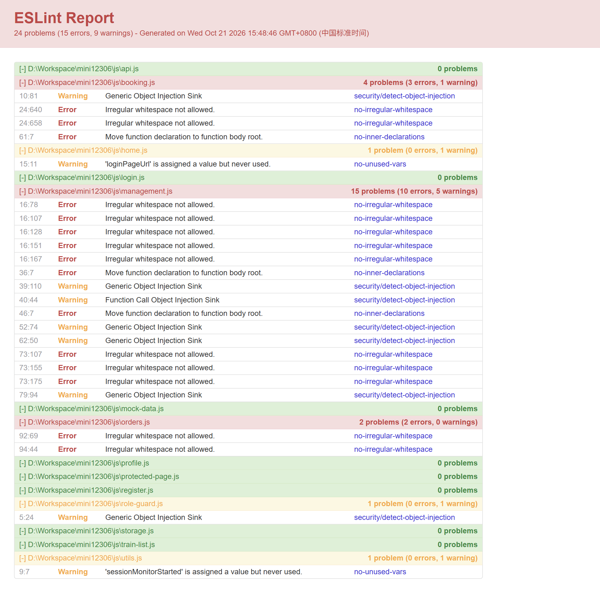
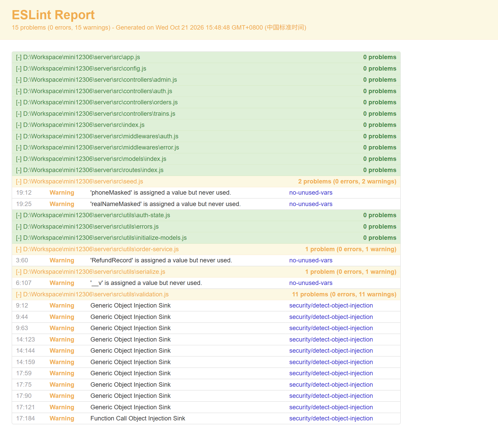
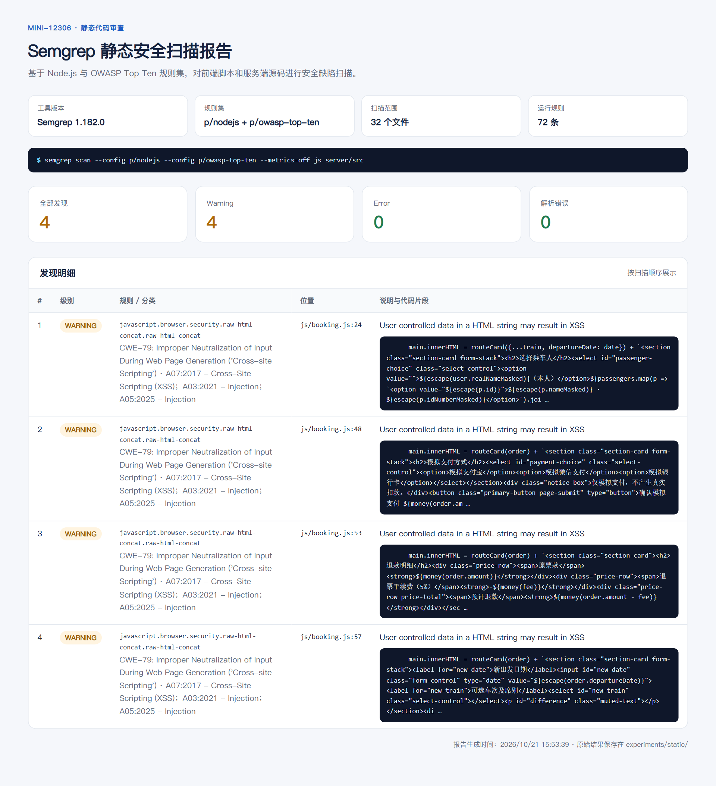
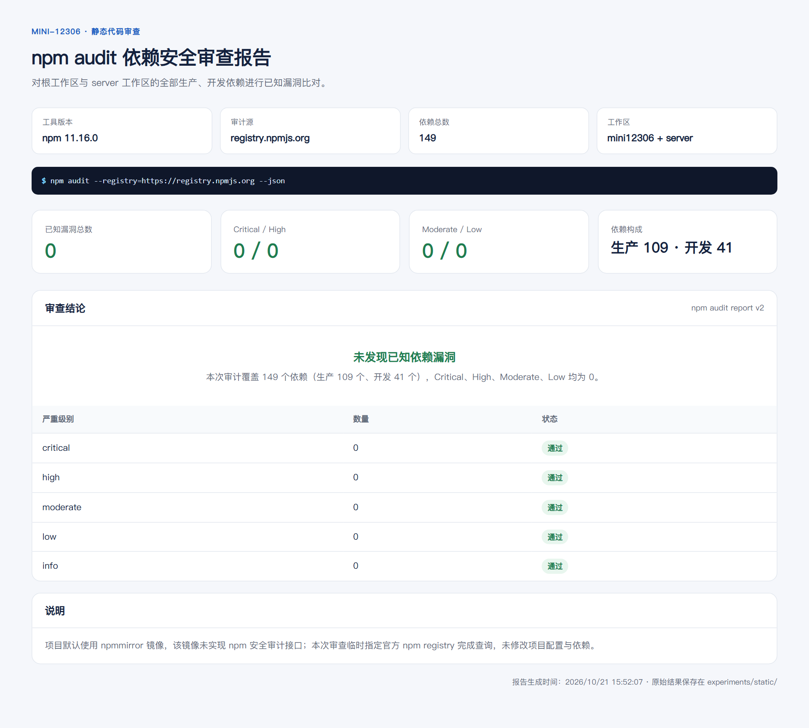
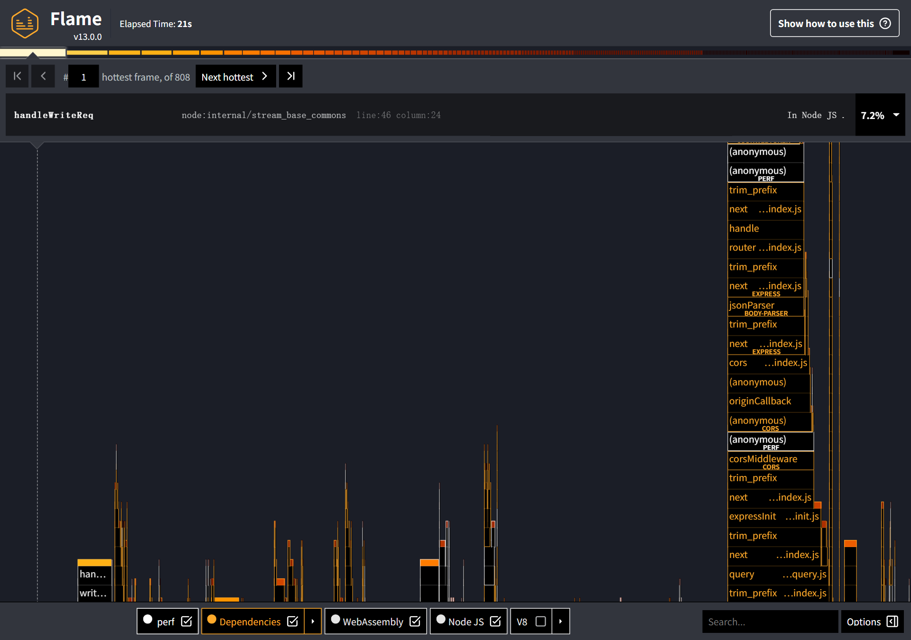
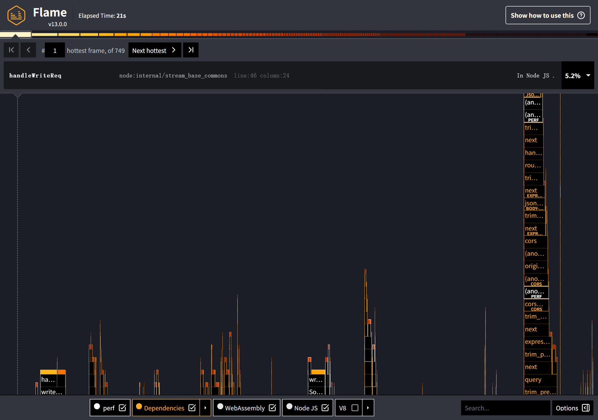

# Mini-12306 静态代码审查与性能优化实验报告

> **提交说明**：正式报告直接填写课程模板，为 `experiments/实验报告书.docx`（含优化前后完整源代码对照）；本文件是详细技术底稿，保留完整分析过程与数据索引。

- **实验日期**：2026-10-22
- **第二轮补充优化测量日期**：2026-10-25（独立测量，不复用、不合并实验二数字）
- **项目**：Mini-12306（原生 HTML/CSS/JS 前端 + Node.js/Express + MongoDB）
- **运行环境**：Windows 11 x64、Node.js 24.18.0、npm 11.16.0、MongoDB 7.0.14（Docker Desktop 29.9.2 / Linux 容器，单节点副本集 `rs0`）、Microsoft Edge
- **实验一约定**：只审查、不改代码。
- **实验二约定**：针对车次查询接口做可测量的性能优化，并保留优化前后代码与数据。

---

## 一、结论摘要

### 实验一：静态代码审查

| 工具 | 版本 | 结果 | 结论 |
| --- | --- | --- | --- |
| ESLint + eslint-plugin-security | 8.57.1 / 3.0.1 | 前端 24 个问题（15 error、9 warning）；后端 15 个 warning | 无可阻断发布的错误；主要是不可见空白、块内函数声明和启发式安全告警 |
| Semgrep | 1.182.0 | 4 条 XSS 告警，均在 `js/booking.js` | 人工复核为误报：所有插值均经过 `escape()` |
| npm audit | npm 11.16.0 | 0 个漏洞，149 个依赖 | 依赖层面未发现已知 CVE |

### 实验二：性能优化

| 指标 | 优化前 | 优化后 | 变化 |
| --- | --- | --- | --- |
| 吞吐量（50 连接，3×15 s 平均） | 343.8 req/s | 424.0 req/s | **+23.3%** |
| 平均延迟 | 145.62 ms | 117.72 ms | **-19.2%** |
| P50 延迟 | 133 ms | 114 ms | **-14.3%** |
| P99 延迟 | 254 ms | 196 ms | **-22.8%**（单轮仍有波动） |
| 查询扫描文档数 | 8,000 | 3 | **-99.96%** |
| 查询扫描索引键数 | 0 | 6 | 由全表扫描变为索引扫描 |
| 查询执行时间（profiler 中位数） | 3 ms | 0 ms（<1 ms） | **-100%**（低于计时精度） |
| 执行计划 | COLLSCAN | 4 路 IXSCAN | 消除全表扫描 |
| 接口正确性 | 返回 3 趟车 | 返回 3 趟车，余票一致 | 无变化 |
| 自动化测试 | — | 35/35 通过 | 无回归 |

端到端吞吐提升 23.3%，仍明显小于“扫描文档数减少 99.96%”的幅度。原因是该接口每个请求还要执行用户查询、会话查询、库存查询以及 HTTP/JSON 处理；数据库车次查询只占整条请求链路的一部分（Amdahl 定律）。因此本实验同时给出**数据库层指标**和**端到端指标**，避免只用单一数字夸大效果。

---

## 二、实验一：静态代码审查

### 2.1 工具选择

选择了 3 类互补的工具，而不是只跑一个 linter：

1. **ESLint 8.57.1 + eslint-plugin-security 3.0.1**
   - 负责 JavaScript 语法、潜在错误、未使用变量，以及常见的危险模式（动态对象注入、`eval`、不安全正则等）。
   - 优点：本地运行、可配置、结果可导出为 HTML；缺点：基于语法模式，安全规则会产生启发式误报。
2. **Semgrep 1.182.0**
   - 使用 `p/nodejs` 与 `p/owasp-top-ten` 规则集，从语义层面检查 XSS、命令注入、不安全的反序列化等。
   - 优点：规则可读、跨行匹配能力强；缺点：需要人工确认数据流，不能直接等同于漏洞。
3. **npm audit（npm 11.16.0）**
   - 检查依赖树中的已知漏洞。
   - 优点：直接对应 CVE 数据库；缺点：只覆盖第三方依赖，不检查业务代码。

**未选择 SonarQube / CodeQL 的原因**：本机已安装 Docker（用于性能实验的隔离 MongoDB），但 SonarQube 仍需单独部署服务端；CodeQL 需要较重的构建与数据库步骤。对于本次课程实验的规模，上述 3 个工具已经覆盖“代码规范、代码安全、依赖安全”三个层面。

### 2.2 审查范围与执行方式

- 前端：`js/**/*.js`，浏览器环境，ES2022，`eslint:recommended` + security 插件。
- 后端：`server/src/**/*.js`，Node 环境，ES2022，规则同上。
- ESLint 配置：
  - [eslint-browser.json](static/eslint-browser.json)
  - [eslint-server.json](static/eslint-server.json)
- 原始输出：
  - [eslint-browser.txt](static/eslint-browser.txt)
  - [eslint-server.txt](static/eslint-server.txt)
  - [semgrep.txt](static/semgrep.txt)
  - [npm-audit.json](static/npm-audit.json)

> 说明：本节只做审查，没有修改任何业务代码。

### 2.3 ESLint：前端结果



**总计：24 个问题（15 error、9 warning），分布在 6 个文件。**

| 文件 | error | warning | 主要规则 |
| --- | ---: | ---: | --- |
| `js/booking.js` | 3 | 1 | `no-irregular-whitespace`、`no-inner-declarations`、`security/detect-object-injection` |
| `js/management.js` | 10 | 5 | `no-irregular-whitespace`、`no-inner-declarations`、`security/detect-object-injection` |
| `js/orders.js` | 2 | 0 | `no-irregular-whitespace` |
| `js/home.js` | 0 | 1 | `no-unused-vars` |
| `js/role-guard.js` | 0 | 1 | `security/detect-object-injection` |
| `js/utils.js` | 0 | 1 | `no-unused-vars` |

按规则归类：

| 规则 | 数量 | 级别 | 说明与判断 |
| --- | ---: | --- | --- |
| `no-irregular-whitespace` | 12 | error | 模板字符串中存在不可见空白字符（如全角/不换行空格）。不会直接造成运行时错误，但会制造难以察觉的 diff、复制粘贴问题和字符串比较问题，建议清理。 |
| `no-inner-declarations` | 3 | error | 在块级作用域内声明函数。现代浏览器可运行，但函数提升语义容易误读，建议移到函数体顶层。 |
| `security/detect-object-injection` | 7 | warning | 动态对象下标访问。多数是从已校验的字段名或固定枚举中取值，属于启发式告警，需要逐条确认，不能直接判为漏洞。 |
| `no-unused-vars` | 2 | warning | `home.js` 的 `loginPageUrl`、`utils.js` 的 `sessionMonitorStarted` 未被使用，属于死代码，可清理。 |

**前端判断**：没有阻断发布的错误。12 个 error 都是格式/可维护性问题，3 个是函数声明位置问题；7 个对象注入 warning 不能直接当漏洞，但提示了动态键访问需要保持输入白名单。

### 2.4 ESLint：后端结果



**总计：15 个 warning，0 个 error。**

| 文件 | warning | 说明 |
| --- | ---: | --- |
| `server/src/utils/validation.js` | 11 | `security/detect-object-injection`，主要是按字段名动态读取校验规则；需要确认字段名来自代码常量/白名单，而不是用户可控字符串。 |
| `server/src/seed.js` | 2 | 解构出的 `phoneMasked`、`realNameMasked` 未使用。 |
| `server/src/utils/order-service.js` | 1 | 引入的 `RefundRecord` 未使用。 |
| `server/src/utils/serialize.js` | 1 | 解构出的 `__v` 未使用，用于从输出中剔除版本字段。 |

**后端判断**：没有语法/潜在运行时错误。对象注入告警集中在校验工具中，属于需要结合调用方确认的启发式规则；未使用变量是清理项，不影响功能。

### 2.5 Semgrep：语义安全扫描



**结果：4 条告警，全部为 `javascript.browser.security.raw-html-concat.raw-html-concat`，严重级别 WARNING。**

| 文件:行 | 规则 | 告警 |
| --- | --- | --- |
| `js/booking.js:24` | raw-html-concat | 用户可控数据进入 HTML 字符串，可能导致 XSS |
| `js/booking.js:48` | raw-html-concat | 同上 |
| `js/booking.js:53` | raw-html-concat | 同上 |
| `js/booking.js:57` | raw-html-concat | 同上 |

**人工复核**：`js/booking.js` 第 10 行定义了 `escape()`，对 `& < > " '` 做实体编码；第 12 行的 `routeCard()` 中所有订单字段都经过 `escape()`；第 24/48/53/57 行的 `innerHTML` 拼接中，插值数据也经过 `escape()` 或 `money()`（数值格式化）。因此这 4 条是**误报**，当前代码路径不构成可利用的 XSS。

需要说明的是：`innerHTML` + 字符串模板仍然是容易回归的写法。若后续新增字段时忘记转义，就会重新引入风险。更稳妥的长期方案是改用 DOM API / `textContent`，或引入 Trusted Types；本次实验按要求不做修改，仅记录建议。

### 2.6 npm audit：依赖漏洞



- 初次使用本机默认的 npmmirror 镜像时，`npm audit` 请求 `/-/npm/v1/security/advisories/bulk` 返回 404，无法得到审计结果。
- 改用官方 registry 后成功：
  ```bash
  npm audit --json --registry=https://registry.npmjs.org
  ```
- 结果：**0 个漏洞**（info/low/moderate/high/critical 均为 0），共 149 个依赖（109 个生产依赖、41 个开发依赖）。
- 该结果只代表“依赖的已知 CVE 为 0”，不能替代业务代码审查；ESLint/Semgrep 的业务代码问题仍以各自结果为准。

### 2.7 实验一小结

- 三个工具分别覆盖：代码规范与常见危险模式（ESLint）、语义安全规则（Semgrep）、依赖漏洞（npm audit）。
- 没有发现需要立即修复的高危问题：Semgrep 的 4 条 XSS 告警经复核为误报；ESLint 的 error 均为可维护性问题；npm audit 为 0。
- **实验一未修改任何业务代码。** 建议的清理项（不可见空白、块内函数声明、未使用变量）留待后续单独提交。

---

## 三、实验二：性能优化

### 3.1 优化对象与基线问题

目标接口：

```http
GET /api/trains?from=武汉&to=北京&date=2026-10-25
```

该接口是用户每次查询车次都会走的核心读路径。基线代码位于 [server/src/controllers/trains.js](../server/src/controllers/trains.js)（优化前备份见 [experiments/perf/before/trains.js](perf/before/trains.js)），核心逻辑：

```js
const trains = await Train.find({
  $and: [
    {$or: [{departureCity: from}, {departureStation: from}]},
    {$or: [{arrivalCity: to}, {arrivalStation: to}]}
  ],
  operatingDates: date,
  bookable: true
}).lean();
const inventory = await Inventory.find({trainId: {$in: trains.map(t => t._id)}, date}).lean();
res.json({trains: trains.map(train => ({
  ...plain(train),
  seats: train.seats.map(seat => ({
    ...seat,
    remaining: inventory.find(i => i.trainId === train._id && i.seatType === seat.seatType)?.remaining ?? 0
  }))
}))});
```

通过 profiler 与火焰图确认了两个问题：

1. **车次集合全表扫描**：`trains` 集合只有 `trainNumber` 唯一索引，查询条件里的 `departureCity/departureStation/arrivalCity/arrivalStation/operatingDates/bookable` 没有可用索引。执行计划为 `COLLSCAN`，8,000 条车次全部检查，最后只返回 3 条。
2. **余票匹配是 O(n×m)**：对每趟车的每个席别，都调用 `inventory.find(...)` 线性扫描库存数组。结果集越大，比较次数增长越快。

另外，Clinic Flame 还暴露出一个与数据库无关的热点：`jsonwebtoken` 在每次 `verify()` 时都会先对字符串密钥执行 `createPublicKey()`，失败后才回退到 HMAC 密钥。这个热点在所有受保护接口上都会出现，因此也纳入本次优化。

### 3.2 工具、数据与环境

| 项目 | 配置 |
| --- | --- |
| CPU 分析 | Clinic.js 13.0.0 / Clinic Flame，30 连接、15 s（仅用于热点分析） |
| 负载生成 | Autocannon 8.x，50 连接，3 s 预热 + 3 轮 × 15 s |
| 数据库执行计划 | MongoDB profiler level 2（`system.profile`） |
| 数据规模 | 8,000 趟车、168,000 条库存（8,000 × 7 天 × 3 席别）、1 个测试用户 |
| 查询数据 | 武汉 → 北京，2026-10-25，命中 3 趟车（G1001–G1003） |
| MongoDB | 7.0.14（官方 `mongo:7.0.14` 镜像，Docker Desktop 29.9.2 / Linux 容器），单节点副本集 `rs0`，`127.0.0.1:27017`，独立数据库 `mini12306_perf` |
| Node.js | 24.18.0 |
| 压测参数 | 50 个连接，3 s 预热 + 3 轮 × 15 s |

数据与脚本：

- Docker MongoDB：容器 `mini12306-perf-mongo`，数据卷 `mini12306-perf-mongo-data`，URI 写入 `.mongo-uri`（`mongodb://127.0.0.1:27017/mini12306_perf?replicaSet=rs0`）。
- [seed-large.js](perf/seed-large.js)：只在数据库名包含 `mini12306_perf` 时允许清库并导入大数据。
- [server.js](perf/server.js)：测试服务器，按 `PERF_PHASE` 选择字符串或 KeyObject 密钥，显式传入测试 JWT 密钥，不读取 `server/.env`。
- [load.js](perf/load.js)：autocannon 压测并写入 `results/`。
- [explain.js](perf/explain.js)：用 profiler 采集执行计划、扫描文档数、索引键数和耗时。

> 安全性说明：`server/.env` 含真实密钥，整个实验没有读取或输出该文件；性能脚本使用独立的测试密钥和独立数据库。

### 3.3 基线分析

#### 3.3.1 Clinic Flame 基线



- 30 个连接、15 s 压测：**325.4 req/s，P50 87 ms，P99 186 ms**。
- 火焰图共 808 个节点；界面选中的最热帧是 `handleWriteReq`（7.2%，Node 流写入路径）。解析内嵌数据可见 `createPublicKey` 仍有 55 个采样（约 0.38%），HTML 中该文本出现 20 次。
- 这说明：在 Docker MongoDB 环境下，请求主要受事件循环调度和数据库 I/O 等待限制；但 JWT 验签在每个请求上仍会先尝试一次注定失败的公钥解析，属于可消除的固定开销。

> Clinic 会开启采样与插桩，绝对吞吐与普通 autocannon 不完全一致；这里的 325.4 req/s 只用于基线热点分析，不作为最终对比口径。

#### 3.3.2 MongoDB profiler 基线

| 指标 | 基线值 |
| --- | --- |
| 执行计划 | `COLLSCAN` |
| 扫描文档数 `docsExamined` | 8,000 |
| 扫描索引键数 `keysExamined` | 0 |
| 返回文档数 `nReturned` | 3 |
| 执行时间（中位数） | 3 ms |

基线 `trains` 集合的索引只有 `_id_` 和 `trainNumber_1`，因此每次查询都要检查全部 8,000 条车次文档。

#### 3.3.3 压测基线

最终测量在同一份 Docker 数据库、同一 token、同一查询参数下完成，先基线（无复合索引）后优化（恢复索引），各 3 轮，避免不同时间点机器状态差异带来的偏差：

| 轮次 | 吞吐量 | 平均延迟 | P50 | P99 | 2xx | 非 2xx / 错误 |
| --- | ---: | ---: | ---: | ---: | ---: | ---: |
| 1 | 306.5 req/s | 162.30 ms | 157 ms | 254 ms | 4,598 | 0 / 0 |
| 2 | 369.5 req/s | 134.73 ms | 133 ms | 171 ms | 5,542 | 0 / 0 |
| 3 | 355.4 req/s | 139.82 ms | 132 ms | 312 ms | 5,331 | 0 / 0 |
| **平均/中位数** | **343.8 req/s** | **145.62 ms** | **133 ms** | **254 ms** | **15,471** | **0 / 0** |

> 测量说明：实验早期在非 Docker 环境下还做过一轮独立测量，基线为 392.8/432.5/390.2 req/s；随后连续压测导致整机 I/O 延迟明显上升，优化后归档数据仅为 142.5/148.9/153.3 req/s（Clinic 优化后为 123.7 req/s），低于基线是环境漂移造成的，不能据此判断优化无效或有效。为避免把机器状态变化误判为代码效果，最终改用 Docker 隔离 MongoDB，并在同一容器、同一份数据上重新建库配对测量（343.8 → 424.0 req/s）。早期数据归档到 `perf/archive-pre-docker-2026-10-22/`，不混入最终结论。

### 3.4 优化方案

#### 3.4.1 复合索引 + 四路查询

车次查询有 2×2 = 4 种起终点组合（出发城市/出发车站 × 到达城市/到达车站）。为每种组合建立一条复合索引：

```js
// server/src/models/index.js（第 15–19 行）
trainSchema.index({departureCity: 1, arrivalCity: 1, operatingDates: 1, bookable: 1});
trainSchema.index({departureCity: 1, arrivalStation: 1, operatingDates: 1, bookable: 1});
trainSchema.index({departureStation: 1, arrivalCity: 1, operatingDates: 1, bookable: 1});
trainSchema.index({departureStation: 1, arrivalStation: 1, operatingDates: 1, bookable: 1});
```

同时把原来的“两个 `$or` 用 `$and` 组合”改写为 4 个完整的等值条件分支：

```js
// server/src/controllers/trains.js（第 10–17 行）
const routes = [
  {departureCity: from, arrivalCity: to},
  {departureCity: from, arrivalStation: to},
  {departureStation: from, arrivalCity: to},
  {departureStation: from, arrivalStation: to}
].map(route => ({...route, operatingDates: date, bookable: true}));
const trains = await Train.find({$or: routes}).lean();
```

这样每个 `$or` 分支都能单独匹配一条复合索引，MongoDB 可以执行多路索引扫描并合并结果，而不是先做全表扫描再过滤。

**为什么把 `operatingDates` 和 `bookable` 也放进索引**：它们也是等值过滤条件。放进复合索引后，索引扫描阶段就能排除掉不匹配的日期/不可售车次，减少回表读取的文档数。`operatingDates` 是数组字段，MongoDB 会建立 multikey 索引；对数组元素做等值匹配仍然可以走索引。

#### 3.4.2 余票匹配：从线性查找改为 Map

```js
// 优化前：每个车次、每个席别都遍历库存数组
remaining: inventory.find(i => i.trainId === train._id && i.seatType === seat.seatType)?.remaining ?? 0

// 优化后：先建“车次|席别”哈希表，再 O(1) 查找
const remaining = new Map(inventory.map(i => [`${i.trainId}|${i.seatType}`, i.remaining]));
remaining.get(`${train._id}|${seat.seatType}`) ?? 0
```

复杂度从 O(车次数 × 席别数 × 库存数) 降为 O(库存数 + 车次数 × 席别数)。在当前 3 趟车的小结果集上，绝对 CPU 收益有限；但这是一个会随结果集增长的二次复杂度，提前消除更稳妥。

#### 3.4.3 JWT 密钥对象复用

Clinic 火焰图中的 `createPublicKey` 来自 `jsonwebtoken@9.0.3` 的验签实现：当传入字符串密钥时，它每次都会先尝试把它当作非对称公钥解析，抛错后再回退到 HMAC 密钥。把密钥在启动时一次性转成 `KeyObject`，即可跳过每次请求的失败解析：

```js
// server/src/config.js（第 2、11–12 行）
const { createSecretKey } = require('node:crypto');
// 先转成 KeyObject；否则 jsonwebtoken 每次验签都会尝试 createPublicKey 再回退到 HMAC 密钥。
return { ..., jwtSecret: createSecretKey(Buffer.from(JWT_SECRET)), ... };
```

兼容性验证：用字符串密钥签发的旧 token，仍可被同样字节的 KeyObject 验证；优化后的火焰图中 `createPublicKey` 出现次数为 0（基线 HTML 中出现 20 次）。该改动只改变密钥对象的创建时机，不改变签名算法、密钥字节或 token 格式。

### 3.5 优化前后代码对比

完整的 unified diff：

- [diff-trains.patch](perf/diff-trains.patch)
- [diff-models.patch](perf/diff-models.patch)
- [diff-config.patch](perf/diff-config.patch)

#### `server/src/controllers/trains.js`

```diff
-  const trains = await Train.find({$and: [{$or: [{departureCity: from}, {departureStation: from}]}, {$or: [{arrivalCity: to}, {arrivalStation: to}]}], operatingDates: date, bookable: true}).lean();
+  // 拆成四种起终点组合，每种都能单独命中一条复合索引。
+  const routes = [
+    {departureCity: from, arrivalCity: to},
+    {departureCity: from, arrivalStation: to},
+    {departureStation: from, arrivalCity: to},
+    {departureStation: from, arrivalStation: to}
+  ].map(route => ({...route, operatingDates: date, bookable: true}));
+  const trains = await Train.find({$or: routes}).lean();
   const inventory = await Inventory.find({trainId: {$in: trains.map(t => t._id)}, date}).lean();
-  res.json({trains: trains.map(train => ({...plain(train), seats: train.seats.map(seat => ({...seat, remaining: inventory.find(i => i.trainId === train._id && i.seatType === seat.seatType)?.remaining ?? 0}))}))});
+  // 先按“车次+席别”建索引表，把逐个查找的 O(n×m) 降为 O(n+m)。
+  const remaining = new Map(inventory.map(i => [`${i.trainId}|${i.seatType}`, i.remaining]));
+  res.json({trains: trains.map(train => ({...plain(train), seats: train.seats.map(seat => ({...seat, remaining: remaining.get(`${train._id}|${seat.seatType}`) ?? 0}))}))});
```

#### `server/src/models/index.js`

```diff
 const trainSchema = new Schema({ ... }, options);
+// 车次查询有“城市/车站”四种起终点组合，各建一条复合索引避免全表扫描。
+trainSchema.index({departureCity: 1, arrivalCity: 1, operatingDates: 1, bookable: 1});
+trainSchema.index({departureCity: 1, arrivalStation: 1, operatingDates: 1, bookable: 1});
+trainSchema.index({departureStation: 1, arrivalCity: 1, operatingDates: 1, bookable: 1});
+trainSchema.index({departureStation: 1, arrivalStation: 1, operatingDates: 1, bookable: 1});
```

#### `server/src/config.js`

```diff
 const path = require('node:path');
+const { createSecretKey } = require('node:crypto');
 require('dotenv').config({ path: path.join(__dirname, '../.env') });
...
-  return { mongoUri: MONGO_URI, jwtSecret: JWT_SECRET, ... };
+  // 先转成 KeyObject；否则 jsonwebtoken 每次验签都会尝试 createPublicKey 再回退到 HMAC 密钥。
+  return { mongoUri: MONGO_URI, jwtSecret: createSecretKey(Buffer.from(JWT_SECRET)), ... };
```

### 3.6 优化后验证

#### 3.6.1 功能正确性

- 同一查询返回 3 趟车：G1001、G1002、G1003。
- 席别与余票保持：商务座 40、一等座 100、二等座 500。
- 压测期间所有响应均为 2xx；基线 3 轮合计 15,471 个 2xx，优化后 3 轮合计 19,080 个 2xx，非 2xx 与错误均为 0。
- `npm --prefix server test`：**35 个测试全部通过**，覆盖下单、支付、退票、改签、权限、会话过期、索引迁移等回归场景。

#### 3.6.2 profiler 复核

| 指标 | 基线 | 优化后 |
| --- | ---: | ---: |
| 执行计划 | `COLLSCAN` | 4 路 `IXSCAN` |
| `docsExamined` | 8,000 | 3 |
| `keysExamined` | 0 | 6 |
| `nReturned` | 3 | 3 |
| 执行时间（中位数） | 3 ms | 0 ms（<1 ms，低于 profiler 计时精度） |

优化后的 `planSummary` 明确包含四条复合索引的 `IXSCAN`：

```text
IXSCAN { departureCity: 1, arrivalCity: 1, operatingDates: 1, bookable: 1 }
IXSCAN { departureCity: 1, arrivalStation: 1, operatingDates: 1, bookable: 1 }
IXSCAN { departureStation: 1, arrivalCity: 1, operatingDates: 1, bookable: 1 }
IXSCAN { departureStation: 1, arrivalStation: 1, operatingDates: 1, bookable: 1 }
```

#### 3.6.3 Clinic Flame 复核



- 优化后报告共 749 个节点；当前最热帧仍为 `handleWriteReq`（5.2%，HTTP/流写入路径）。
- `createPublicKey` 在优化后报告中出现 0 次，说明 JWT 密钥构造热点已消除。
- 采样中剩余的顶层帧主要是 `processTicksAndRejections`、`AsyncFunctionAwaitResolveClosure`、mongoose `writeCommand`/`exec` 等 I/O 等待路径，说明当前请求已更多受数据库/网络等待限制，而不是 CPU 计算。
- 本次 Clinic 优化后运行达到 430.8 req/s、P50 66 ms、P99 159 ms，高于基线那一次运行；但 Clinic 会开启采样与插桩，绝对吞吐仍不能与普通 autocannon 直接比较，**前后吞吐以 autocannon 配对测量为准**。

### 3.7 性能指标对比

#### 3.7.1 端到端压测（最终配对口径）

| 轮次 | 基线吞吐 | 优化后吞吐 | 基线 P50 | 优化后 P50 | 基线 P99 | 优化后 P99 |
| --- | ---: | ---: | ---: | ---: | ---: | ---: |
| 1 | 306.5 req/s | 400.8 req/s | 157 ms | 119 ms | 254 ms | 248 ms |
| 2 | 369.5 req/s | 418.6 req/s | 133 ms | 114 ms | 171 ms | 196 ms |
| 3 | 355.4 req/s | 452.6 req/s | 132 ms | 108 ms | 312 ms | 154 ms |
| **平均/中位数** | **343.8 req/s** | **424.0 req/s** | **133 ms** | **114 ms** | **254 ms** | **196 ms** |

计算方式：

```text
吞吐提升 = (424.0 - 343.8) / 343.8 × 100% = +23.33% ≈ +23.3%
P50 改善 = (114 - 133) / 133 × 100% = -14.29%
平均延迟改善 = (117.72 - 145.62) / 145.62 × 100% = -19.16%
P99 改善 = (196 - 254) / 254 × 100% = -22.83%
```

**P99 说明**：基线三轮为 254/171/312 ms，优化后为 248/196/154 ms，中位数从 254 ms 降到 196 ms。优化后三轮均不高于基线中位数，但基线单轮最低为 171 ms，且样本只有 3 轮，因此仍不能把 P99 视为稳定改善；吞吐、平均延迟和 P50 在三轮中均一致向好，是更可靠的结论。

#### 3.7.2 数据库层指标

| 指标 | 基线 | 优化后 | 变化 |
| --- | ---: | ---: | ---: |
| `docsExamined` | 8,000 | 3 | **-99.96%** |
| `executionTimeMillis` | 3 ms | 0 ms（<1 ms） | **-100%**（低于计时精度） |
| `keysExamined` | 0 | 6 | 从无索引扫描变为索引扫描 |
| `nReturned` | 3 | 3 | 结果一致 |

#### 3.7.3 为什么端到端提升 23.3%

该接口的每个请求大致包含：

1. JWT 验签；
2. `User.findById` 查询用户；
3. `Session.findOne` 校验会话；
4. `Train.find` 查询车次（本次优化对象）；
5. `Inventory.find` 查询库存；
6. 组装 JSON 并写回响应。

本次优化把第 4 步从 3 ms、8,000 文档降到低于 1 ms、3 文档，但第 2/3/5 步和 HTTP 处理仍然存在。按 Amdahl 定律，单段加速对整体吞吐的提升受该段占比限制。基线车次查询中位数 3 ms，约占平均请求延迟 145.62 ms 的 2.1%；即使把 3 ms 降到 1 ms 以下，理论上只减少不到 2 ms/请求，约 1.4% 的平均延迟。实测平均延迟下降 27.9 ms（19.2%），高于这一估算，说明 JWT KeyObject 与 Map 也消除了部分固定开销，且测量本身存在波动；三项优化叠加起作用，不能把全部收益单独归因于索引。若要继续提升，应优先减少鉴权链路的数据库往返（例如合并用户/会话查询、做短 TTL 缓存），但这会涉及会话安全与失效语义，本次实验没有贸然改动。

### 3.8 局限与风险

1. **数据集是合成的**：8,000 趟车、168,000 条库存，查询分布单一；真实线路的日期分布、热门线路集中度不同，索引收益会变化。
2. **单机 Docker MongoDB**：容器通过 WSL2 访问数据卷，I/O 路径与本机进程不同；没有跨节点同步和真实网络延迟，绝对吞吐不能直接外推到生产。
3. **机器状态会漂移**：实验早期连续压测后 I/O 延迟明显上升，因此改为 Docker 隔离并重新建库配对测量；即便如此，P99 仍有明显波动，3 轮样本不足以稳定估计尾部延迟。
4. **Clinic 采样开销**：Clinic Flame 适合定位热点，不适合作为吞吐基准；本报告已把 Clinic 与 autocannon 两组数据分开。
5. **索引有写入与存储成本**：4 条复合索引会增加车次写入时的索引维护成本和磁盘占用。车次查询是读多写少的路径，这个 trade-off 合理；若未来车次写入非常频繁，需要重新评估。
6. **KeyObject 改动涉及配置类型**：`config.jwtSecret` 从字符串变为 `KeyObject`。当前 `jwt.sign`/`jwt.verify` 都支持该类型，测试也全部通过；但如果项目外还有代码把 `config.jwtSecret` 当字符串使用，需要同步调整。
7. **实验一与实验二的代码状态不同**：实验一未修改代码；实验二修改了 `server/src/controllers/trains.js`、`server/src/models/index.js`、`server/src/config.js` 三个业务文件，并增加了实验脚本。两者在提交时应分别说明。

### 3.9 第二轮补充优化（选做，独立测量）

日期：2026-10-25。本节是在实验二之外做的第二轮补充优化与独立测量，**不修改实验二的车次查询参数、结果数字和结论**。第二轮使用单独的 MongoDB 容器（`127.0.0.1:27019`，库名 `mini12306_perf_round2`）、独立的测试 JWT 密钥和单独的 `experiments/perf/round2/` 脚本；实验二仍是主体优化。两轮数据不能相加，也不能把本节百分比写成“在 424.0 req/s 基础上继续提升”。

完整方法、原始 JSON 与限制见 [第二轮性能测量.md](第二轮性能测量.md)，代码改动与功能验证见 [第二轮优化验证.md](第二轮优化验证.md)。

#### 3.9.1 站点接口缓存

`GET /api/trains/stations` 原来每次请求都执行一次全表读取，在 8,000 趟车的库上重复物化全部城市/车站：

```javascript
// 优化前：server/src/controllers/trains.js 的 stations
const trains = await Train.find().select('departureCity arrivalCity departureStation arrivalStation').lean();
res.json({stations: [...new Set(trains.flatMap(t => [t.departureCity, t.arrivalCity, t.departureStation, t.arrivalStation]))].filter(Boolean)});
```

新增 `server/src/utils/station-cache.js`，提供 5 分钟 TTL 的进程内缓存；缓存未命中时用 `inFlight` 合并并发请求，用 `generation` 防止失效前的在途旧查询回填，返回数组副本避免调用方污染缓存，查询失败不缓存：

```javascript
const STATION_CACHE_TTL_MS = 5 * 60 * 1000;
let cachedStations = null;
let expiresAt = 0;
let generation = 0;
let inFlight = null;

function getStations() {
  if (cachedStations !== null && Date.now() < expiresAt) return Promise.resolve([...cachedStations]);
  if (inFlight) return inFlight.promise.then(stations => [...stations]);
  const startedGeneration = generation;
  const flight = {};
  flight.promise = Promise.resolve().then(async () => {
    const trains = await Train.find().select('departureCity arrivalCity departureStation arrivalStation').lean();
    const stations = [...new Set(trains.flatMap(train => [train.departureCity, train.arrivalCity, train.departureStation, train.arrivalStation]))].filter(Boolean);
    if (generation === startedGeneration) { cachedStations = stations; expiresAt = Date.now() + STATION_CACHE_TTL_MS; }
    return stations;
  }).finally(() => { if (inFlight === flight) inFlight = null; });
  inFlight = flight;
  return flight.promise.then(stations => [...stations]);
}
```

`controllers/trains.js` 的 `stations` 改为 `res.json({stations: await getStations()});`。`controllers/admin.js` 在车次新增、修改、删除事务成功提交后调用 `invalidateStationCache()`，递增 generation 并清空缓存；失败事务不会失效。

50 并发结果（autocannon，15 s × 3 次中位数）：

| 指标 | before（每次读库） | after（缓存） | 变化 |
| --- | ---: | ---: | ---: |
| 吞吐量 | 6.7 req/s | 300.0 req/s | +4,377.6%（44.8 倍） |
| 平均延迟 | 6,233.66 ms | 166.03 ms | -97.34% |
| P50 | 5,160 ms | 163 ms | -96.84% |
| P99 | 8,296 ms | 428 ms | -94.84% |
| 2xx / 非 2xx / 错误 | 100 / 0 / 0 | 4,500 / 0 / 0 | 无错误 |

顺序请求与数据库工作量：

| 指标 | before | after | 说明 |
| --- | ---: | ---: | --- |
| 20 次顺序请求中位延迟 | 62.56 ms | 15.12 ms | -75.83%，约 4.1 倍 |
| 顺序 P95 | 72.21 ms | 16.63 ms | -76.97% |
| 冷缓存首个请求 | 231.14 ms | 255.09 ms | 单次采样，无提升 |
| 每请求 `trains` 查询次数 | 1 | 冷 1 / 热 0 | 热缓存窗口 10 次请求 profiler 未捕获 |
| 每请求扫描文档数 | 8,000 | 冷 8,000 / 热 0 | before 另有 8 次 `getMore` |

44.8 倍是“8,000 车次 + 50 并发”这一特定对照环境的数字，不能外推为生产倍数。缓存命中路径仍要执行 JWT 校验、用户查询和会话查询，300 req/s 与 15 ms 不是“零成本”；冷请求仍需读库，缓存消除的是后续请求的重复整表读取。

#### 3.9.2 订单过期复合索引

`expireOrders` 的查询条件是 `{status: 'pending', expiresAt: {$lte: now}}`，原索引只有 `{userId: 1, status: 1}`，无法服务“状态 + 过期时间”的全局扫描。新增：

```diff
// server/src/models/index.js
 orderSchema.index({userId: 1, status: 1});
+orderSchema.index({status: 1, expiresAt: 1});
 orderSchema.index({userId: 1, requestId: 1}, {unique: true});
```

实际索引名为 `status_1_expiresAt_1`，是查询索引而非 TTL 删除索引，不绕过订单事务。

`executionStats` 对照（7 条已过期 pending + 3 条未过期 pending）：

| 指标 | 无索引 | 有索引 | 变化 |
| --- | ---: | ---: | ---: |
| docsExamined | 20,000 | 7 | -99.97% |
| keysExamined | 0 | 7 | 进入索引范围 |
| nReturned | 7 | 7 | 一致 |
| 执行时间（中位数） | 9 ms | 0 ms（<1 ms） | 低于计时精度 |
| 执行计划 | COLLSCAN | IXSCAN `status_1_expiresAt_1` → FETCH | 消除全表扫描 |

订单列表接口 50 并发（3 次中位数）：

| 指标 | before | after | 变化 |
| --- | ---: | ---: | ---: |
| 吞吐量 | 125.6 req/s | 136.5 req/s | +8.68% |
| 平均延迟 | 393.7 ms | 363.89 ms | -7.57% |
| P50 | 398 ms | 357 ms | -10.30% |
| P99 | 778 ms | 650 ms | -16.45% |
| 错误数 | 0 | 0 | — |

索引把每次过期查询的扫描从 20,000 文档降到 7，但接口吞吐只提升 8.68%，因为该接口还要执行 JWT 校验、用户/会话查询、订单列表查询和 JSON 序列化。这个百分比不能写成通用吞吐提升，也不能与实验二的 +23.3% 相加。

#### 3.9.3 过期清理 single-flight

原 `expireOrders` 每次调用都独立执行一轮“扫描 + 逐订单事务”：

```javascript
// 优化前
async function expireOrders() {
  return runExpiration();
}
```

优化后，同一 Node.js 进程内同一时刻只允许一轮清理，其余调用者复用同一个 Promise：

```javascript
let expirationFlight = null;
function expireOrders() {
  if (!expirationFlight) {
    expirationFlight = runExpiration().finally(() => { expirationFlight = null; });
  }
  return expirationFlight;
}
```

`runExpiration` 保留原有的 pending/expiresAt 条件、逐订单事务和库存释放。

10 个并发 `GET /api/orders`、20 条已过期 pending 订单，每个变体 3 轮：

| 指标 | 无 single-flight | 有 single-flight | 变化 |
| --- | ---: | ---: | ---: |
| 过期扫描次数（3 轮） | 10 / 10 / 10 | 1 / 1 / 1 | -90% |
| 取消订单数（每轮） | 20 | 20 | 一致 |
| HTTP 200 请求数（每轮） | 10 | 10 | 一致 |
| 墙钟中位数 | 3,395.64 ms | 3,216.86 ms | -5.26%（波动大） |

墙钟范围：无合并 3,216.32–3,946.79 ms，有合并 1,375.35–3,635.54 ms，两者重叠，不能声称稳定延迟收益。确定收益是把 10 个调用者的重复扫描合并为 1 次；20 条订单的逐条事务仍是主要耗时，合并不会减少事务数量。

#### 3.9.4 验证、边界与小结

- 自动化测试：`npm.cmd --prefix server test` 共 47 项，47 通过、0 失败、0 跳过，退出码 0。新增覆盖缓存命中/失效/TTL/并发合并/旧查询回填保护、清理合并、管理员真实 API 刷新，以及真实数据库的索引与库存释放。
- 管理员新增、修改、删除车次成功后立即失效缓存；下单只更新 `revision`，不改变城市/车站，因此不失效公共站点缓存。
- 缓存和 single-flight 都只在单个 Node.js 进程内生效；外部 seed、直接写库或其他实例的写入最多等待 5 分钟 TTL。数据库条件更新和事务仍是防止重复释放的最终保护。
- 本节没有修改实验二的参数、数字和结论，没有读取 `server/.env`，没有操作实验二的 27017 容器/数据卷或 27018 demo；第二轮容器测量后已停止，数据卷 `mini12306-perf-round2-mongo-data` 保留。

小结：三项改动中站点缓存收益最大，直接消除了热路径上的整表读取；订单索引把单次过期查询从 20,000 文档降到 7 条；single-flight 把并发过期扫描从 10 次降到 1 次，但没有测到稳定墙钟收益。订单接口 +8.68% 再次说明数据库层的局部改善会被鉴权、查询和序列化等固定开销稀释，必须与端到端指标一起报告。

---

## 四、复现步骤

### 4.1 静态审查

```bash
# 在项目根目录执行；工具依赖安装在 experiments/tools
cd experiments/tools && npm install && cd ../..

# ESLint（前端）
experiments/tools/node_modules/.bin/eslint \
  -c experiments/static/eslint-browser.json js --ext .js

# ESLint（后端）
experiments/tools/node_modules/.bin/eslint \
  -c experiments/static/eslint-server.json server/src --ext .js

# Semgrep（需自行安装 Semgrep 1.182.0）
semgrep --config p/nodejs --config p/owasp-top-ten \
  --json --output experiments/static/semgrep.json .

# npm audit（使用官方 registry）
cd server && npm audit --json --registry=https://registry.npmjs.org
```

### 4.2 性能实验

```bash
# 1. 启动隔离 MongoDB（Docker Desktop / Linux 容器）
docker run -d --name mini12306-perf-mongo \
  -p 127.0.0.1:27017:27017 \
  -v mini12306-perf-mongo-data:/data/db \
  mongo:7.0.14 mongod --replSet rs0 --bind_ip_all
docker exec mini12306-perf-mongo mongosh --quiet \
  --eval 'rs.initiate({_id:"rs0",members:[{_id:0,host:"127.0.0.1:27017"}]})'
# experiments/perf/.mongo-uri 写入：
# mongodb://127.0.0.1:27017/mini12306_perf?replicaSet=rs0

# 2. 基线：恢复 experiments/perf/before/ 的三个源码快照后导入数据
node experiments/perf/seed-large.js

# 3. 登录测试用户并写入 .token
node experiments/perf/get-token.js

# 4. 基线：另开终端启动 3100 端口，采集执行计划并压测
PERF_PHASE=baseline node experiments/perf/server.js
node experiments/perf/explain.js baseline
node experiments/perf/load.js baseline

# 5. 恢复 after/ 与优化代码，启动优化服务后复测
PERF_PHASE=optimized node experiments/perf/server.js
node experiments/perf/explain.js optimized
node experiments/perf/load.js optimized

# 6. 汇总指标
node experiments/perf/summarize.js
```

Clinic Flame 基线（示例，基线/优化分别使用不同输出目录）：

```bash
NO_INSIGHT=1 PERF_PHASE=baseline DURATION=15 CONNECTIONS=30 \
  experiments/tools/node_modules/.bin/clinic flame \
  --dest experiments/perf/clinic-before-docker --name baseline \
  --on-port "node experiments/perf/load-on-port.js" \
  -- node experiments/perf/server.js
```

> 注意：`--` 不能省略，否则 Clinic 会把 `node experiments/perf/server.js` 当作多余参数并打印帮助。`NO_INSIGHT=1` 用于跳过非交互终端的遥测确认。

### 4.3 清理

```bash
# 停止测试服务进程后，按需停止并删除容器（数据卷保留）
docker stop mini12306-perf-mongo
# 如不再需要实验数据：
# docker rm mini12306-perf-mongo
# docker volume rm mini12306-perf-mongo-data
```

---

## 五、实验结论

1. **静态审查**：ESLint 发现 24 个前端问题（15 error/9 warning）和 15 个后端 warning，主要是不可见空白、块内函数声明、对象注入启发式告警和未使用变量；Semgrep 的 4 条 XSS 告警经复核为误报；npm audit 为 0 漏洞。没有发现需要立即修复的高危问题，且实验一未修改代码。
2. **性能优化**：
   - 通过 4 条复合索引与四路查询，把车次查询从 `COLLSCAN` 改为 4 路 `IXSCAN`，扫描文档数从 8,000 降到 3（-99.96%），查询时间从 3 ms 降到 0 ms（低于 1 ms 计时精度）。
   - 通过 `Map` 把余票匹配从 O(n×m) 降为 O(n+m)。
   - 通过复用 JWT `KeyObject`，消除了火焰图中 `createPublicKey` 热帧（HTML 中出现次数 20 → 0）。
   - 端到端配对压测：吞吐 343.8 → 424.0 req/s（+23.3%），平均延迟 145.62 → 117.72 ms（-19.2%），P50 133 → 114 ms（-14.3%），P99 254 → 196 ms（-22.8%，单轮仍有波动）。
   - 基线/优化共 15,471/19,080 个请求全部为 2xx，35/35 自动化测试通过，接口返回结果和余票一致。
3. **工程启示**：优化前先测量，优先优化占比最大的路径；数据库扫描优化很显著，但端到端收益会被鉴权、库存查询和 HTTP 开销稀释。报告同时保留数据库层和端到端两组指标，避免用局部数字代表整体。
4. **第二轮补充优化（选做，独立测量）**：站点缓存消除了热路径的整表读取，50 并发 6.7 → 300.0 req/s（特定对照，不可外推），20 次顺序请求中位延迟 62.56 → 15.12 ms（-75.8%）；订单过期索引把单次扫描从 20,000 文档降到 7 条，订单接口 50 并发吞吐 +8.68%；single-flight 把并发过期扫描从 10 次降到 1 次。47/47 自动化测试通过。该轮数据独立，**不与实验二的 343.8 → 424.0 req/s 相加**。

---

## 附录：交付物索引

| 内容 | 路径 |
| --- | --- |
| 实验报告 | `experiments/实验报告.md` |
| LLM 交互记录 | `experiments/LLM交互记录.md` |
| ESLint 前端截图 | `experiments/assets/static-01-eslint-frontend.png` |
| ESLint 后端截图 | `experiments/assets/static-02-eslint-server.png` |
| Semgrep 截图 | `experiments/assets/static-03-semgrep.png` |
| npm audit 截图 | `experiments/assets/static-04-npm-audit.png` |
| Clinic 基线截图 | `experiments/assets/perf-01-clinic-baseline.png` |
| Clinic 优化后截图 | `experiments/assets/perf-02-clinic-optimized.png` |
| 压测原始结果 | `experiments/perf/results/` |
| 指标汇总 | `experiments/perf/results/summary.json` |
| 代码 diff | `experiments/perf/diff-*.patch` |
| 优化前源码备份 | `experiments/perf/before/` |
| 优化后源码快照 | `experiments/perf/after/` |
| 第二轮性能测量说明 | `experiments/第二轮性能测量.md` |
| 第二轮优化验证记录 | `experiments/第二轮优化验证.md` |
| 第二轮脚本与对照变体 | `experiments/perf/round2/` |
| 第二轮指标汇总 | `experiments/perf/round2/results/round2-summary.json` |
| 第二轮原始结果 | `experiments/perf/round2/results/` |
